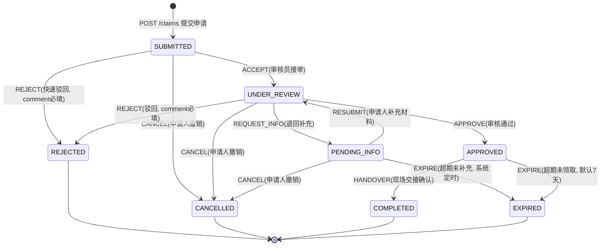

# 设计模型 02 — 认领单审核状态机图

> 复用 api-contract-v0.md §4 迁移表。实线=用户/审核员事件，虚线=系统超时事件。

## 迁移不变量（代码实现必须满足）

| # | 不变量 |
|---|---|
| I1 | 终态 REJECTED/CANCELLED/COMPLETED/EXPIRED 无出边，任何事件返回 40001 |
| I2 | 每次迁移写一条 review_record(action, from_status, to_status, comment) |
| I3 | APPROVE 后同一 found_item 不得再产生新的可推进认领单（物品转 PICKUP_PENDING） |
| I4 | HANDOVER 时 found_item→CLAIMED，物品闭环 |
| I5 | REJECT / REQUEST_INFO 的 comment 必填，缺省返回 40003 |
| I6 | APPROVE / HANDOVER 仅限已接单的 reviewer 本人（越权 40002） |

## 伴随动作表

| 迁移 | 伴随动作 |
|---|---|
| →APPROVED | found_item.status=PICKUP_PENDING；通知申请人"审核通过，请7天内领取"，deadline=+7天 |
| →PENDING_INFO | deadline=+7天；通知申请人补充凭证 |
| →COMPLETED | found_item.status=CLAIMED；通知双方交接完成 |
| →REJECTED | 通知申请人驳回原因；found_item 保持可被其他认领单推进 |
| →EXPIRED | 通知申请人；若为 APPROVED 超期，found_item 回退 REGISTERED |
| →CANCELLED / →UNDER_REVIEW(RESUBMIT) | 通知对方当事人 |
