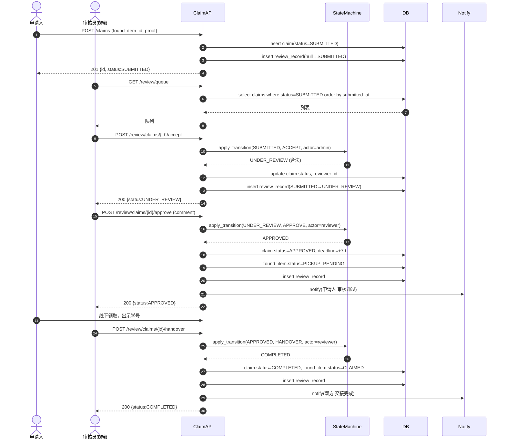
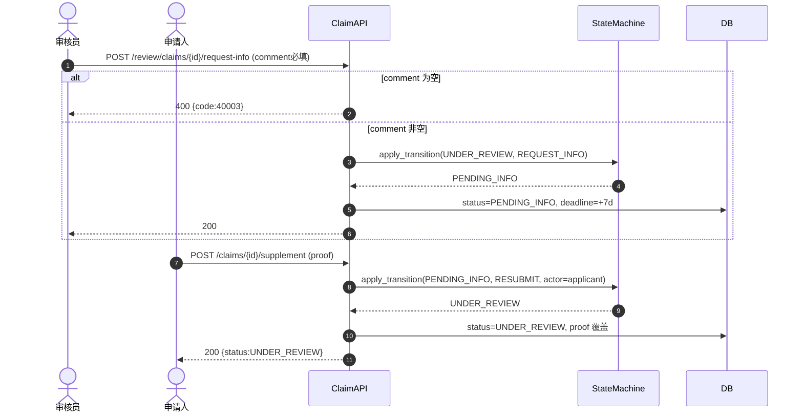

# 设计模型 04 — 时序图（审核通过主流程 + 退回补充分支）

## 4.1 主流程：提交 → 接单 → 通过 → 交接



## 4.2 分支：退回补充 → 申请人补充 → 重新审核



## 4.3 异常：非法迁移

```mermaid
sequenceDiagram
    actor A as 审核员
    participant C as ClaimAPI
    participant S as StateMachine

    A->>C: POST /review/claims/8/approve
    Note over C: claim#8 已 REJECTED(终态)
    C->>S: apply_transition(REJECTED, APPROVE)
    S-->>C: raise IllegalTransition
    C-->>A: 400 {code:40001, message:"ILLEGAL_TRANSITION",
                  detail:"REJECTED 不允许事件 APPROVE"}
```
