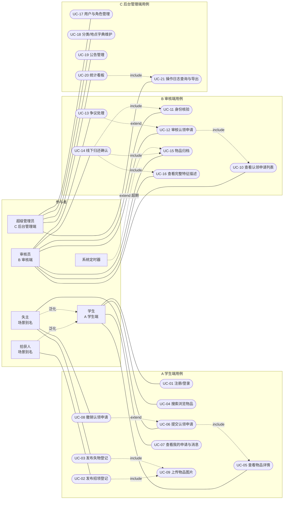
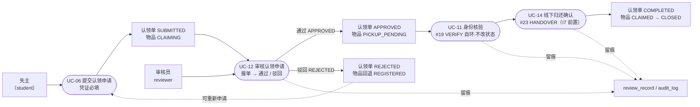
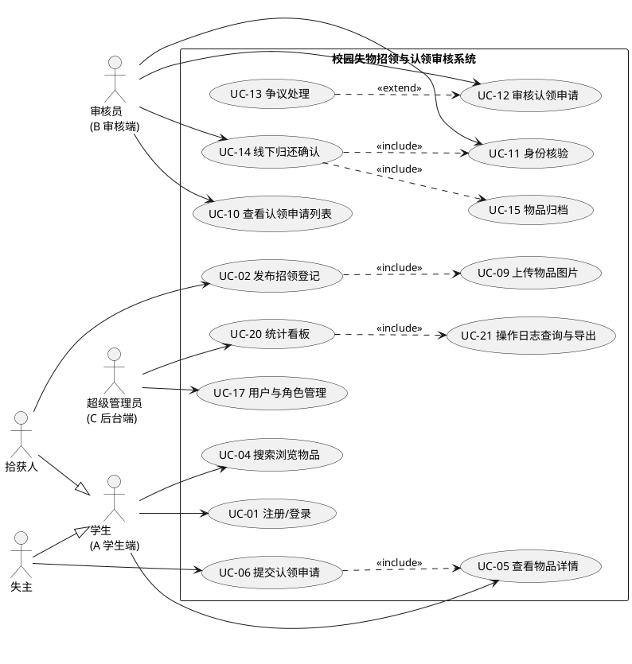

# 用例图（4 图之 1）

| 项目 | 内容 |
|---|---|
| 课题 | 校园失物招领与认领审核系统（第 2 组） |
| 文档编号 | UC-v1 |
| 版本 | v1（按契约 v1 定稿） |
| 负责人 | 阴亮 |
| 日期 | 2026-11-04 |
| 状态 | **已定稿**；以《api-contract-v1.md》为唯一口径，§7 用例↔接口↔用例↔演示步追踪表已填实 |
| 组图 | 4 图之 1：用例图（本文件）；之 2–4：顺序图、分析类图、状态图，见《需求4图-补齐3张.md》（阴亮，已交付） |
| 绘图规范 | 全部 Mermaid 代码块，不生成图片；编号空间、图题、引用写法与变更流程见《全组约定与编号总则-v1.md》§2 / §4 / §5；附录 B 附 PlantUML 备用代码 |

---

## 1 目的与范围

用例图从**外部参与者视角**界定系统边界与功能范围，是《需求说明书》§3 功能需求、`FR-xx` 编号、批次 2《需求—演示对照表》的共同依据。

系统边界：三端（A 学生端 / B 审核端 / C 后台管理端），单工程、RBAC 三角色。范围外的能力见《需求说明书-前两章》§1.2。

---

## 2 参与者

| 编号 | 参与者 | 类型 | 说明 | 主要目标 |
|---|---|---|---|---|
| ACT-01 | 学生 | 主要参与者 / 系统角色 | 契约角色枚举之一；A 学生端 | 找回物品、上交拾获物品 |
| ACT-02 | 拾获人 | 场景别名 | **学生的场景称呼，不新增系统角色**；图中以泛化关系表示 | 发布招领登记 |
| ACT-03 | 失主 | 场景别名 | 同上，不新增系统角色 | 搜索物品、提交认领申请 |
| ACT-04 | 审核员 | 主要参与者 / 系统角色 | B 审核端，课题「认领审核」核心 | 身份核验、审核、归还确认 |
| ACT-05 | 超级管理员 | 主要参与者 / 系统角色 | C 后台管理端 | 用户/字典/公告/统计/日志 |
| ACT-06 | 系统定时器 | 次要参与者（系统） | 超期归档触发（公示期天数待契约确认） | 自动归档 |

> 严谨性说明：正式 UML 中「拾获人 / 失主」若与「学生」权限完全相同，建议只保留「学生」一个参与者；此处画出仅为让评审一眼看清两类业务动作，答辩时按上面这句解释即可。

---

## 3 用例清单

### 3.1 A 学生端

| 编号 | 用例名 | 简述 | 对应需求 |
|---|---|---|---|
| UC-01 | 注册 / 登录 | 学号注册、登录、按角色进入对应端 | FR-01 |
| UC-02 | 发布招领登记 | 拾获人录入物品分类/地点/时间/特征/图片/保管点 | FR-02 |
| UC-03 | 发布失物登记 | 失主录入遗失信息 | FR-03 |
| UC-04 | 搜索浏览物品 | 按分类 / 地点 / 时间筛选 | FR-04 |
| UC-05 | 查看物品详情 | 查看状态与脱敏后的特征描述 | FR-05 |
| UC-06 | 提交认领申请 | 附身份与特征说明，发起认领 | FR-06 |
| UC-07 | 查看我的申请与消息 | 查看申请状态与审核结果通知 | FR-07 |
| UC-08 | 撤销认领申请 | 未审核前主动撤回 | FR-06 扩展 |
| UC-09 | 上传物品图片 | 登记时的图片上传 | FR-02 / FR-03 |

### 3.2 B 审核端

| 编号 | 用例名 | 简述 | 对应需求 |
|---|---|---|---|
| UC-10 | 查看认领申请列表 | 按状态筛选待处理申请 | FR-08 |
| UC-11 | 身份核验 | 审核通过后、交接前核对到场人学号与姓名；`APPROVED` 自环、不改状态，写 `VERIFY` 流水（I7 / #19） | FR-09 |
| UC-12 | 审核认领申请 | 通过 / 驳回（附驳回意见），驱动物品状态流转 | FR-10 / FR-11 |
| UC-13 | 争议处理 | 多人认领或冒领疑议时复核并留痕 | FR-11 |
| UC-14 | 线下归还确认 | 当面交接后确认归还，生成归还记录 | FR-12 |
| UC-15 | 物品归档 | 流程终结，转入历史台账 | FR-11 |
| UC-16 | 查看完整特征描述 | 仅审核端可见，用于核验 | FR-09 |

### 3.3 C 后台管理端

| 编号 | 用例名 | 简述 | 对应需求 |
|---|---|---|---|
| UC-17 | 用户与角色管理 | 账号、角色、启停 | FR-13 |
| UC-18 | 分类 / 地点字典维护 | 统一叫法与保管点 | FR-14 |
| UC-19 | 公告管理 | 发布 / 下架公告 | FR-15 |
| UC-20 | 统计看板 | 登记量、归还率、审核时效 | FR-16 |
| UC-21 | 操作日志查询与导出 | 追溯关键动作，Excel 导出 | FR-16 |

---

## 4 用例图

### 4.1 图 3-1　系统总用例图（三端）

**图 3-1　系统总用例图（三端 / 三类角色）**

> 实线为关联，虚线标注 `include`（必做子流程）/ `extend`（条件触发）/ 泛化。因 Mermaid 无原生 usecase 图元，用 stadium 节点模拟用例椭圆、矩形节点模拟小人；需要标准 UML 图形时用附录 B 的 PlantUML 代码。

### 4.2 图 3-2　认领审核核心子图（课题亮点）

**图 3-2　认领审核子流程（含驳回回退与留痕）**

状态口径（《api-contract-v1.md》§2 / §5）：认领单 8 态 `SUBMITTED`→`UNDER_REVIEW`→`APPROVED`→`COMPLETED`，旁路 `PENDING_INFO` / `REJECTED` / `CANCELLED` / `EXPIRED`；物品 5 态 `REGISTERED`→`CLAIMING`→`PICKUP_PENDING`→`CLAIMED`，旁路 `CLOSED`。驳回、撤销、超期时物品回退 `REGISTERED`。

---

## 5 关系说明表

| 关系 | 从 | 到 | 语义 |
|---|---|---|---|
| 泛化 | 拾获人 / 失主 | 学生 | 场景别名，权限与账号完全相同 |
| include | UC-02 / UC-03 发布登记 | UC-09 上传图片 | 登记必含图片 |
| include | UC-06 提交认领申请 | UC-05 查看详情 | 必须基于某件物品发起 |
| include | UC-14 归还确认 | UC-11 身份核验 | **审核通过后、交接前必须核验通过（I7），不可跳过** |
| include | UC-12 审核 | UC-10 申请列表 | 从待办列表进入审核 |
| include | UC-14 归还确认 | UC-16 / UC-15 | 交接前复核特征，交接后归档 |
| include | UC-20 统计看板 | UC-21 日志查询 | 统计数据源自日志与台账 |
| extend | UC-08 撤销 | UC-06 提交申请 | 仅「未审核」状态可撤销 |
| extend | UC-13 争议处理 | UC-12 审核 | 多人认领 / 冒领疑议时触发 |
| extend | 系统定时器超期 | UC-15 归档 | 超期规则见契约 v1 §5 `EXPIRE`（#24） |

---

## 6 核心用例规约

### 6.1 UC-12　审核认领申请（完整规约）

| 项 | 内容 |
|---|---|
| 用例编号 | UC-12 |
| 用例名 | 审核认领申请（通过 / 驳回） |
| 主参与者 | 审核员（B 审核端） |
| 次要参与者 | 学生（申请结果的接收方） |
| 前置条件 | 审核员已登录、具备 `reviewer` 角色并已接单（I6）；认领单为 `UNDER_REVIEW`；物品为 `CLAIMING` |
| 后置条件（成功） | 认领单 → `APPROVED`；物品 → `PICKUP_PENDING`（等待到场核验与交接）；deadline=+7d；写 `review_record` 与 `audit_log`；学生收到结果通知 |
| 后置条件（失败/驳回） | 认领单 → `REJECTED`（意见必填）；物品回退 `REGISTERED`；写 `review_record` 与操作日志 |
| 触发事件 | 审核员在申请列表点击「审核」 |
| 对应需求 | FR-09 / FR-10 / FR-11 |
| 优先级 | P0（主流程必通） |

**主成功流程**

| 步 | 审核员动作 | 系统响应 |
|---|---|---|
| 1 | 打开认领申请列表（#17） | 展示 `SUBMITTED` 队列，按提交时间升序（UC-10） |
| 2 | 选中一条申请，进入详情 | 展示申请人身份信息、物品信息、物品完整特征描述（ UC-16 ） |
| 3 | 接单（#18 ACCEPT） | 认领单 `SUBMITTED`→`UNDER_REVIEW`，锁定 reviewer_id |
| 4 | 核对申请人描述与物品特征是否一致 | 给出一致性提示，不自动放行 |
| 5 | 选择「通过」并填写意见，提交 | 校验权限 → 写入审核流水 `review_record` → 认领单置 `APPROVED`（审核通过·待领取）→ 写操作日志 → 通知学生 |
| 6 | — | 用例结束，等待 **UC-11 身份核验 → UC-14 线下归还确认**（演示步 12–13） |

**扩展流**

| 分支 | 条件 | 处理 |
|---|---|---|
| 3a | 已被他人接单 / 并发 | 按 I6 拒绝，提示「申请已被接单」 |
| 4a | 多人认领同一物品 | 触发 UC-13 争议处理，暂缓结论，留痕 |
| 5a | 选择「驳回」（#21） | 意见必填 → 认领单 `REJECTED` → **物品回退 `REGISTERED`** → 写 `review_record` 与日志 → 通知学生 |
| 5b | 重复提交 / 并发审核 | 乐观锁或状态校验拒绝第二次提交，提示「申请已处理」 |
| 5c | 写库失败 | 事务回滚，不产生半条审核记录，提示重试 |
| 5d | 交接时未核验 / 核验不通过 | 不属本用例；由 UC-11 与 #23 依 I7 阻断交接，返回 `40003` |
| 任意 | 审核员越权（学生账号调用） | RBAC 拒绝，记安全日志 |

**业务规则**：BR-01 禁止自动放行；BR-04 驳回必须回退物品状态；BR-06 关键动作必须留痕；BR-07 学生不得执行审核。

### 6.2 其他核心用例摘要

| 编号 | 前置 | 主成功结果 | 关键扩展 |
|---|---|---|---|
| UC-06 提交认领申请 | 学生已登录、物品 `REGISTERED` | 认领单 `SUBMITTED`，物品 `CLAIMING` | 凭证 `proof` 必填；已存在未处理申请则拒绝重复提交；UC-08 撤销 |
| UC-11 身份核验 | 认领单 `APPROVED`、申请人到场 | 写 `VERIFY` 流水，**状态不变**（#19 自环） | 学号/姓名不一致 → verified=false，交接被 I7 阻断 |
| UC-14 线下归还确认 | 认领单 `APPROVED` 且 VERIFY 已通过（I7） | 认领单 `COMPLETED`，物品 `CLAIMED` | 未核验就交接返回 `40003`；核验不通过中止交接 |
| UC-13 争议处理 | 同一物品多条申请 | 复核结论 + 留痕 | 移交超级管理员查看日志（不作审核结论） |

---

## 7 图与其他材料的追踪

| 用例 | 需求 | 契约 v1 接口 # | 测试用例 | 演示脚本步 |
|---|---|---|---|---|
| UC-02 发布招领登记 | FR-02 | #5, #9 | TC-FOUND-01/05/08 | 步 2 |
| UC-04 搜索浏览 | FR-04 | #7, #8, #10 | TC-FOUND-02/03 | 步 4-5 |
| UC-06 提交认领申请 | FR-06 | #12 | TC-CLAIM-01~04 | 步 6 |
| UC-11 身份核验 | FR-09 | **#19**（APPROVED 自环 + I7） | 冒烟第 3 组 | 步 12 |
| UC-12 审核 | FR-10 | #20, #21, #22 | TC-REV-05~12 | 步 11 |
| UC-14 归还确认 | FR-12 | #23 | 冒烟「未核验就交接」 | 步 13 |

> 依据 `api-contract-v1.md` §3 与《演示脚本-v0.md》§2 填实（2026-11-04）。本表在批次 2 直接扩写成《需求—演示对照表》（阴亮 + 金道轩）与《测试用例表》（欧阳昊天）。

---

## 附录 A　自检清单

- [x] 三类角色 + 系统定时器，三端用例分组齐全
- [x] 主流程 7 步均有对应用例
- [x] 课题亮点「身份核验 / 审核通过 / 驳回」有独立用例
- [x] include / extend / 泛化关系齐全并有文字说明
- [x] 至少 1 份完整用例规约（含扩展流与业务规则）
- [x] 图全部 Mermaid，图题图注齐全
- [x] 用例 ↔ 接口 ↔ 测试用例 ↔ 演示步编号已按契约 v1 补齐（§7）
- [x] 与 `api-contract-v1.md` 核对三角色、9 表、8 态状态机后定稿
- [x] 身份核验顺序为「审核通过后、交接前」（`APPROVED` 自环 + I7），全文无 v0 角色代号与旧状态口径残留

## 附录 B　PlantUML 备用代码（需要标准 UML 图形时用）

> 本组仍以 Mermaid 交付；此段仅供答辩排版时生成标准小人/椭圆图形，粘贴到 PlantUML 渲染器即可。

## 附录 C　修订记录

| 版本 | 日期 | 修改人 | 说明 |
|---|---|---|---|
| v0 | 2026-11-04 | 阴亮 | 批次 0：4 图之 1 用例图，含总图、审核子图、21 个用例与核心规约 |
| v1 | 2026-11-04 | 阴亮 | 按 `api-contract-v1.md` 重修：身份核验改「审核通过后、交接前」APPROVED 自环 + I7；三角色、8 态枚举、§7 追踪表填实 |
| v1 修订 | 2026-11-04 | 阴亮 | 绘图规范改为引用《全组约定与编号总则-v1.md》；技术口径未变，不升版本号 |
