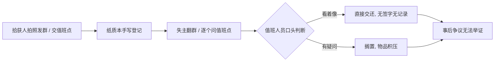
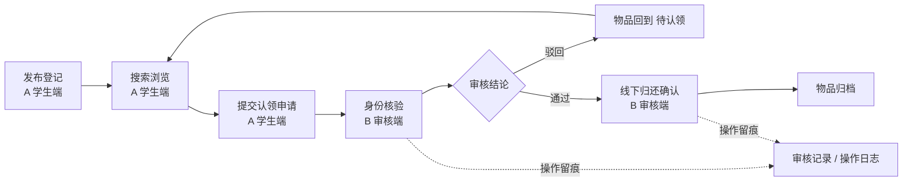

# 软件需求规格说明书（前两章）

| 项目 | 内容 |
|---|---|
| 课题 | 校园失物招领与认领审核系统（第 2 组） |
| 文档编号 | SRS-v0-PT1 |
| 版本 | v0（批次 0：仅第 1、2 章） |
| 负责人 | 阴亮 |
| 日期 | 2026-11-04 |
| 状态 | 初版；**第 3 章起待接口契约 v0 到手后于批次 1 补全** |
| 编制依据 | GB/T 8567《计算机软件文档编制规范》SRS 结构（课程设计裁剪版）、《全员任务总清单》、李子研《任务 01｜数据字典与接口契约》 |

> 本文件是《需求说明书.md》的前两章，批次 1 在其后接续 3–6 章与附录，不另起炉灶。全文术语以《术语表-v0.md》为准。

---

## 1 引言

### 1.1 编写目的

本文档描述「校园失物招领与认领审核系统」的业务问题、用户、范围与需求规定，作为本组 3 天课程设计的**唯一需求基线**，供以下对象使用：

| 读者 | 用途 |
|---|---|
| 组长（阴亮） | 组织分工、批次 2 术语对齐、全套材料终审 |
| 设计负责人（李子研） | 编写设计说明书、6 种设计模型、ER 图与状态机 |
| 开发（邓昌兴 / 金道轩 / 李子研 / 欧阳昊天） | 按需求搭三端骨架、写 A/B/C 端代码 |
| 测试与演示（欧阳昊天 / 金道轩） | 逐条写测试用例表、15 步演示脚本、答辩题库 |
| 课程评审教师 | 核对需求分析与需求模型评分项 |

本文档同时是批次 2《需求—设计对照表》《需求—演示对照表》的左侧基准。

### 1.2 范围

**系统名称**：校园失物招领与认领审核系统。

**要做的**：以「物品」台账为主体，把校园内拾获登记、失物登记、搜索浏览、认领申请、**身份核验**、**审核通过/驳回**、线下归还确认、归档串成一条可追溯的闭环；用 RBAC 区分 A 学生端、B 审核端、C 后台管理端；对审核与归还等关键动作操作留痕。

**不做的（明确边界，防止范围蔓延）**：

| 不做 | 原因 |
|---|---|
| 悬赏、酬金、在线支付 | 涉及资金与合规，超出课程设计范围 |
| 物流配送、快递取件 | 归还采用线下面对面交接 |
| 接入校园一卡通 / 统一身份认证真实接口 | 演示环境用学号 + 模拟身份核验 |
| 人脸识别、证件 OCR 自动鉴别 | 身份核验由审核员人工核对材料完成 |
| 跨校区多租户、移动端原生 App | 单校区、单工程、Web 三端 |
| 自动匹配推送失主 | v0 由学生主动搜索，不做智能推荐 |

**三端范围**（与接口契约 v0 一致）：

| 端 | 主要能力 |
|---|---|
| A 学生端 | 注册登录、发布失物/招领登记（含图片）、按分类/地点/时间搜索筛选、查看物品详情、提交认领申请、查看我的申请与消息通知 |
| B 审核端 | 认领申请列表、身份核验、审核通过/驳回、物品状态流转、争议处理、操作留痕 |
| C 后台管理端 | 用户管理、分类/地点字典维护、公告、数据统计看板、操作日志查询、Excel 导出 |

### 1.3 定义、缩写与术语

全文术语见《术语表-v0.md》，此处仅列高频项：

| 术语 | 本文含义 |
|---|---|
| 物品 | 一条拾获/招领登记对应的实物台账记录，状态流转的主体 |
| 认领申请 | 失主对某件物品提出认领并接受核验、审核的单据 |
| 身份核验 | 审核员核对申请人身份与物品特征，判断是否本人 |
| 审核员 | B 审核端执行身份核验与审核的角色 |
| 三端 | A 学生端 / B 审核端 / C 后台管理端，单工程内按 RBAC 区分 |
| 主流程 | 发布登记 → 搜索浏览 → 提交认领申请 → 身份核验 → 审核通过/驳回 → 线下归还确认 → 物品归档 |

缩略语：SRS（需求规格说明书）、RBAC（基于角色的访问控制）、FR（功能需求，编号 `FR-xx`）、UC（用例）、GB/T 8567（《计算机软件文档编制规范》）。

### 1.4 参考资料

1. GB/T 8567—2006《计算机软件文档编制规范》
2. GB/T 9385《计算机软件需求规格说明规范》
3. 软件工程课程设计任务书与评分表（需求分析 30、需求模型 30、设计规格 20、设计模型 30、编码 100、软件测试 25、演示 20、团队协作 10、回答问题 10、PPT 50 等）
4. 本组《全员任务总清单—先产出后对接》
5. 李子研《api-contract-v0.md》（数据字典与接口契约，**批次 1 补章的依据**）
6. 邓昌兴《技术选型.md》（Vue3 + Spring Boot + MySQL）
7. 欧阳昊天《格式规范.md》（封面、页眉、编号、字体）

### 1.5 文档约定

- 需求编号 `FR-xx`，按三端分组；每条需求必须**可测试、可演示**。
- 优先级：`P0` 主流程必通（彩跑项）、`P1` 重要、`P2` 有余力再做。
- 未完成内容写 `[待补：内容，负责人，批次]`，禁止「略」「待定」。
- 图一律 Mermaid 代码块；图题 `图 x-y`，表题 `表 x-y`。
- 引用其他材料写 `《文件名》§章节号`。

---

## 2 任务概述

### 2.1 问题定义与实际意义

#### 2.1.1 现状：失物招领靠「群 + 本子」

目前校园内遗失与拾获物品主要靠三种 informal 渠道：朋友圈/表白墙/微信群转发、各楼栋值班点的纸质登记本、同学之间口头相传。这些渠道能勉强「传消息」，但**没有流程、没有审核、没有留痕**，一旦涉及证件、钥匙、手机等高价值物品，问题立刻暴露。

#### 2.1.2 真实用户与痛点

> 系统的真实用户不是抽象的「用户」，而是下面 5 类具体的人；痛点必须落到他们各自的一次具体操作上。

| # | 真实用户 | 典型场景 | 现在怎么做 | 具体痛点 | 系统对应能力 |
|---|---|---|---|---|---|
| U1 | **拾获物品的学生**（拾获人） | 在食堂捡到一张校园卡/一串钥匙 | 拍照发群、或交到值班点让工作人员记在本子上 | 不知道该交给谁、登记内容全凭手写；发出去后无人跟进，物品长期堆在抽屉；「我明明交上去了」无凭据 | 发布招领登记（分类/地点/时间/图片/保管点），状态可查，操作留痕 |
| U2 | **丢失物品的学生**（失主） | 丢了学生证/耳机，第二天要考试 | 翻十几个群、逐个问值班点、在表白墙刷屏 | 信息分散、检索只能靠关键词和时间线；无法按地点/时间/分类筛；看到帖子也不知道东西还在不在 | 按分类/地点/时间搜索筛选、查看物品状态与详情、在线提交认领申请 |
| U3 | **审核员**（失物招领处值班老师 / 学生助理 / 保卫处值守） | 有人来认领一部手机 | 凭口述与肉眼判断，偶尔看一下学生证，纸质本上签个字 | **冒领风险最高的一环**：无身份核验标准、无审核结论记录；多人认领同一物品时无争议处理依据；交接后出问题无法举证 | B 审核端：申请列表、身份核验、审核通过/驳回、争议处理、审核记录与操作日志 |
| U4 | **超级管理员**（后台管理） | 学期末要统计招领成效、清理字典 | 翻纸质本、手工汇总 Excel | 分类/地点叫法不统一；无统计数据、无日志查询；公告无处发布 | C 后台端：用户与字典维护、公告、统计看板、操作日志查询、Excel 导出 |
| U5 | **院系/辅导员**（外部干系人，不设系统角色） | 学生来开遗失证明、投诉冒领 | 电话追问值班点 | 缺少可追溯凭据，纠纷处理周期长 | 从操作日志与归还记录导出凭证 |

#### 2.1.3 问题归因

把上表收敛成三个可设计的根因：

| 根因 | 表现 | 设计对策 |
|---|---|---|
| **信息无结构** | 帖子、纸质本各自为政，无分类/地点/时间/状态字段 | 建立统一「物品」台账 + 分类/地点字典 |
| **流程无闭环** | 发布之后没有申请、核验、审核、归还、归档的状态概念 | 引入物品状态机与认领申请状态；审核驳回回退「待认领」 |
| **权责无留痕** | 谁核验、谁批准、谁领走，全靠记忆 | 审核记录 + 归还记录 + 操作日志，RBAC 限定动作权限 |

其中「**认领审核**」是本课题区别于普通失物招领公告板的关键：不是谁先说东西是自己的就给谁，而是**身份核验 + 审核结论 + 留痕**三件事一起构成可追责的闭环。

#### 2.1.4 实际意义

| 层面 | 意义 | 可度量目标（建议值，批次 1 与测试组确认） |
|---|---|---|
| 对学生 | 丢失后一个入口检索，认领进度可见，减少刷群与跑腿 | 检索到目标物品 ≤ 3 次筛选；申请提交后状态实时可见 |
| 对管理方 | 冒领有核验、审核有结论、交接有记录，纠纷可举证 | 关键动作留痕率 100%；认领申请审核时限 ≤ 1 个工作日 |
| 对物品保管 | 状态与保管点清晰，超期归档，避免长期积压 | 每件物品状态唯一且可追踪；已归还/已归档可追溯 |
| 对课程实践 | 完整走一遍需求→设计→编码→测试→演示→答辩，产出 6 份材料与可运行三端系统 | 主流程彩排一次跑通；FR 全部被 TC 与演示步骤覆盖 |
| 对团队协作 | 5 人并行、先出东西再对接，契约驱动，过程记录可查 | 情况记录表逐日填写；术语对齐零残留 |

> 目标值为**建议**，不是承诺；批次 2 交叉对照时按实际实现修订。

### 2.2 业务背景

#### 2.2.1 场景特征

- 物品类别集中：证件（学生证、身份证、校园卡）、电子设备（手机、耳机、U 盘）、钥匙、书本、衣物、其他。
- 高发地点集中：食堂、教学楼、图书馆、宿舍楼、运动场；拾获后通常交至就近保管点。
- 时间敏感：证件类直接影响考试、门禁、出行；失主往往在数小时内主动寻找。
- **特征信息敏感**：物品的颜色、刻字、内含物、锁屏壁纸等是判断归属的关键证据，若在公开列表页全文展示，等于给冒领者提供答案。因此特征描述需分级可见（列表脱敏、审核端可见），列为安全需求（批次 1 §3.5）。

#### 2.2.2 现状流程（As-Is）

**图 2-1　现状失物招领流程（无审核、无留痕）**

现状的断点在 D：判断依据、判断人、判断结论三者都没有被系统记录。

#### 2.2.3 目标流程（To-Be，与接口契约 v0 一致）

**图 2-2　目标主流程（7 步闭环）**

物品状态：**待认领 → 审核中 →（驳回回待认领 / 通过）→ 已归还 → 已归档**（枚举与英文值以契约 v0 为准）。

#### 2.2.4 业务规则与风险

| 编号 | 规则 / 风险 | 要求 |
|---|---|---|
| BR-01 | 冒领 | 认领必须经过身份核验 + 审核结论，禁止自动放行 |
| BR-02 | 特征泄露 | 公开列表页不展示完整特征描述 |
| BR-03 | 多人认领同一物品 | 支持争议处理，一个物品同时仅有一条有效审核流 |
| BR-04 | 驳回后无人再领 | 驳回回「待认领」，物品重新可搜索 |
| BR-05 | 长期无人认领 | 超公示期归档（天数待契约/批次 1 确认） |
| BR-06 | 交接纠纷 | 归还确认必须留痕，含领取人、核验人、时间 |
| BR-07 | 权限越界 | 学生不得执行审核；身份核验、审核仅审核员可做 |

### 2.3 建设目标与约束

| 类型 | 内容 |
|---|---|
| 功能目标 | 跑通主流程 7 步；A/B/C 三端各自功能齐备；审核与留痕为亮点 |
| 技术约束 | Vue3 + Spring Boot + MySQL，单工程、前后端分离、RBAC 三端；表名/字段名 snake_case，接口 `/api` 前缀 |
| 工期约束 | **3 天**；允许使用 AI；批次 0 全部并行、不等契约 |
| 协作约束 | 先各自出文件再对接；Git 相关（仓库、提交规范、commit 粒度、版本库截图）**暂缓**至代码能跑通、材料齐备后 |
| 质量约束 | 术语全文一致；图统一 Mermaid；需求可测试、可演示；每人通读自己主责文档 |
| 环境约束 | 演示在课程设计本机环境运行，使用模拟演示账号，不接真实统一身份认证 |

### 2.4 用户与角色

| 角色 | 端 | 核心权限 | 禁止 |
|---|---|---|---|
| 学生 | A 学生端 | 发布登记、搜索、提交认领申请、查看自己的申请与消息 | 审核、核验、查看他人完整特征描述、用户管理 |
| 审核员 | B 审核端 | 查看申请与完整特征、身份核验、审核通过/驳回、争议处理、归还确认 | 用户管理、字典维护、统计导出 |
| 超级管理员 | C 后台管理端 | 用户管理、分类/地点字典、公告、统计看板、操作日志、Excel 导出 | 代替审核员作审核结论（避免权责混淆） |

### 2.5 假定与依赖

| # | 假定 / 依赖 | 影响 | 责任人与时点 |
|---|---|---|---|
| D-1 | 李子研《api-contract-v0.md》定义字段名、状态枚举、≥ 8 张表、≥ 20 个接口 | 第 3 章数据需求、设计说明书、三端代码、测试用例全部依赖它 | 李子研，批次 0 末 |
| D-2 | 技术选型确认为 Vue3 + Spring Boot + MySQL | 第 4 章运行环境 | 邓昌兴，批次 0 |
| D-3 | 统一格式规范已发布 | 全套材料排版 | 欧阳昊天，批次 0 |
| D-4 | 演示环境可准备三类角色账号与演示数据 | 15 步演示与彩排 | 金道轩 + 邓昌兴，批次 2 |
| D-5 | 线下归还由人工当面完成 | 系统只做「确认」不做物流 | 全组共识 |
| D-6 | 身份核验为人工核对，不做生物识别 | 安全需求边界 | 全组共识 |

---

## 附录 A　批次 1 待补章节清单

| 章节 | 内容 | 依赖 | 负责人 |
|---|---|---|---|
| 3.1 功能需求 | `FR-01…` 按 A/B/C 三端逐条写，标 P0/P1/P2 | 契约 v0 | 阴亮 |
| 3.2 业务主流程 | 逐步展开 7 步，标注角色、端、状态变化 | 契约 v0 | 阴亮 |
| 3.3 数据需求 | 引用契约 v0 数据字典、ER 图 | 契约 v0 | 阴亮 |
| 3.4 性能需求 | 列表响应、分页、并发 | 技术选型 | 阴亮 |
| 3.5 安全与隐私 | RBAC、特征脱敏、身份核验、留痕 | 契约 v0 | 阴亮 |
| 3.6 输入输出与接口 | 引用《接口文档》 | 契约 v0 | 阴亮 |
| 3.7 故障处理 | 重复提交、并发审核、上传失败 | — | 阴亮 |
| 4 运行环境 | 版本、浏览器、网络、数据库 | 技术选型 | 阴亮 |
| 5 优先级与验收 | P0 主流程必通 | 演示脚本 | 阴亮 + 金道轩 |
| 6 需求追踪矩阵 | FR ↔ UC ↔ 接口 ↔ TC ↔ D | 全员产出 | 阴亮（批次 2） |

## 附录 B　初始功能需求索引（供李子研 / 欧阳昊天对表用）

> 编号占位，详细规约于批次 1 §3.1 展开；此处仅用于建立追踪关系，不替代需求条目。

| 编号 | 端 | 需求名 | 优先级 |
|---|---|---|---|
| FR-01 | A | 注册 / 登录 | P0 |
| FR-02 | A | 发布招领登记（含图片） | P0 |
| FR-03 | A | 发布失物登记 | P1 |
| FR-04 | A | 按分类 / 地点 / 时间搜索筛选 | P0 |
| FR-05 | A | 查看物品详情（特征脱敏） | P0 |
| FR-06 | A | 提交认领申请 | P0 |
| FR-07 | A | 查看我的申请与消息通知 | P1 |
| FR-08 | B | 认领申请列表与详情 | P0 |
| FR-09 | B | 身份核验 | P0 |
| FR-10 | B | 审核通过 / 驳回（含驳回意见） | P0 |
| FR-11 | B | 物品状态流转与争议处理 | P0 |
| FR-12 | B | 线下归还确认 + 操作留痕 | P0 |
| FR-13 | C | 用户与角色管理 | P1 |
| FR-14 | C | 分类 / 地点字典维护 | P1 |
| FR-15 | C | 公告发布 | P2 |
| FR-16 | C | 统计看板 / 日志查询 / Excel 导出 | P1 |

## 附录 C　修订记录

| 版本 | 日期 | 修改人 | 说明 |
|---|---|---|---|
| v0 | 2026-11-04 | 阴亮 | 批次 0：完成第 1 章引言、第 2 章任务概述（问题定义与实际意义、业务背景） |
