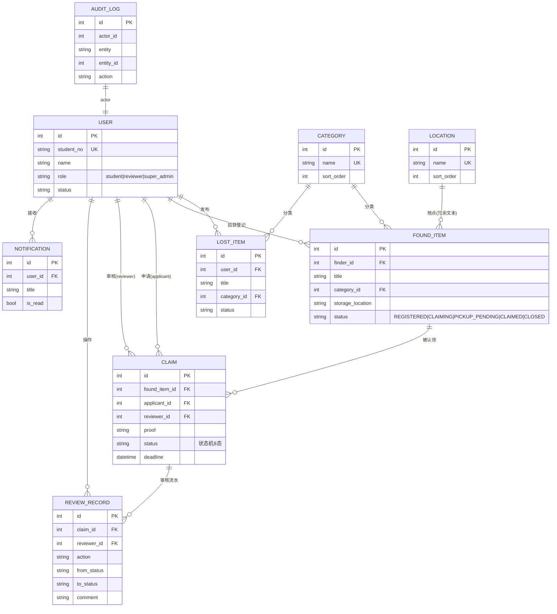
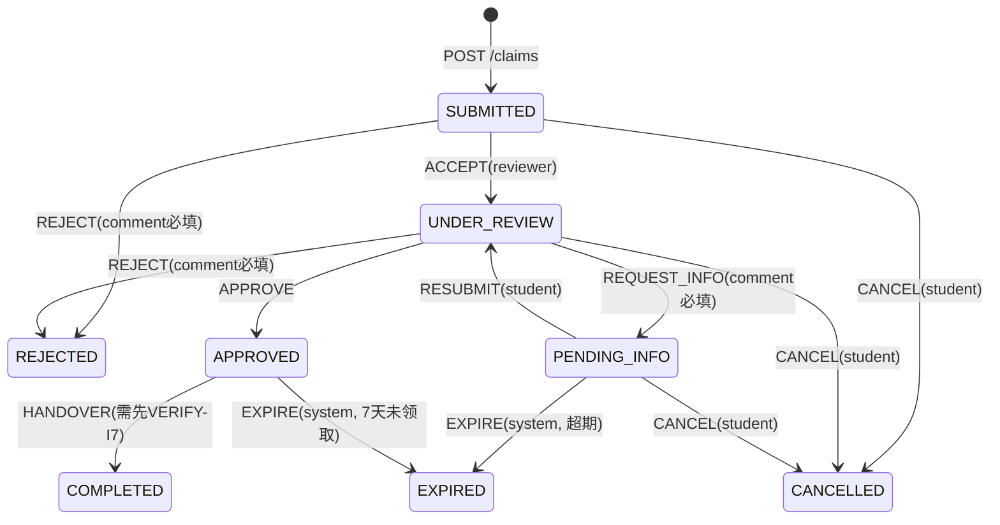

# api-contract-v1.md — 校园失物招领与认领审核系统 · 数据字典 + 接口契约 v1

> **版本历史**：v0（2026-11-04 上午冻结）→ 按验收清单解冻 → **v1（本版，重新冻结）**
> **v1 变更**（对应验收返工 P0/P2）：
> 1. 角色由 `user/admin` 改为 **`student` / `reviewer` / `super_admin`** 三角色，消除 `admin` 代号与《术语表-v0》C 端超级管理员的撞车；
> 2. 表由 7 张补至 **9 张**：新增 `category`、`location` 字典表；`audit_log` 转正为必建表；全部表补「非空 / 默认值」列；
> 3. 接口按 **A/B/C 三端**分组（共 30 条 ≥20），每条含允许角色、关键参数、响应要点；
> 4. 新增 **身份核验独立接口** `POST /review/claims/{id}/verify`，并新增状态机不变量 I7（交接前必须核验通过）；
> 5. 契约内**内嵌 ER 图与状态机图**（Mermaid），不再只存在于设计模型目录；
> 6. 新增 **三端功能 ↔ 接口对照表**（§7）。
> 维护人：李子研 ｜ 状态：**已重新冻结，改动须先群里声明**

## 0. 解冻 / 重冻结声明（可直接粘贴群公告）

> 【契约解冻→重冻结】@全体 api-contract 由 v0 升级到 v1 并重新冻结：①角色改为 student/reviewer/super_admin（admin 代号废弃，C 端与三端整合请以 v1 为准）；②新增 category/location 两张字典表，共 9 张；③接口按 A/B/C 三端分组共 30 条，新增身份核验接口 POST /review/claims/{id}/verify，交接前必须先核验（不变量 I7）；④契约内已内嵌 ER 图/状态机图/三端对照表。本条即冻结声明，之后改动需群里重新声明。变更明细见 api-contract-v1.md 文件头。

---

## 1. 角色与术语

| 角色代号 | 名称 | 端 | 说明 |
|---|---|---|---|
| `student` | 普通学生用户 | A 端 | 发布失物启事 / 拾获登记 / 提交认领申请 |
| `reviewer` | 审核员 | B 端 | 执行认领审核状态流（接单→核验→审核→交接） |
| `super_admin` | 超级管理员 | C 端 | 用户管理、字典维护、公告、统计、日志、导出 |

> ⚠️ `admin` 代号在 v1 中**废弃**：v0 中 `admin`=审核员，与《术语表-v0》中 `admin`=C 端超级管理员冲突。全组代码、文档、测试用例统一使用上表三个代号。

| 术语 | 说明 |
|---|---|
| found_item | 拾获登记（别人捡到的物品） |
| lost_item | 失物启事（寻物） |
| claim | 认领申请（核心实体，携带审核状态机） |
| review_record | 审核流水（状态机每次迁移一条，可回放历史） |

## 2. 数据字典（9 张表）

> 列说明：NN=NOT NULL 非空；DEF=默认值。

### 2.1 user 用户表
| 字段 | 类型 | NN | DEF | 说明 |
|---|---|---|---|---|
| id | INT PK | ✅ | 自增 | 主键 |
| student_no | VARCHAR(20) | ✅ | — | 学号，UNIQUE |
| name | VARCHAR(50) | ✅ | — | 姓名 |
| role | VARCHAR(20) | ✅ | `student` | `student` / `reviewer` / `super_admin` |
| phone | VARCHAR(20) | ❌ | `''` | 联系电话 |
| password_hash | VARCHAR(128) | ✅ | — | 口令哈希 |
| status | VARCHAR(10) | ✅ | `ACTIVE` | `ACTIVE` / `DISABLED`（C 端可停用） |
| created_at | DATETIME | ✅ | 当前时间 | 创建时间 |

### 2.2 category 物品分类字典表（v1 新增）
| 字段 | 类型 | NN | DEF | 说明 |
|---|---|---|---|---|
| id | INT PK | ✅ | 自增 | 主键 |
| name | VARCHAR(20) | ✅ | — | 分类名，UNIQUE |
| sort_order | INT | ✅ | 0 | 前端下拉排序 |

### 2.3 location 地点字典表（v1 新增）
| 字段 | 类型 | NN | DEF | 说明 |
|---|---|---|---|---|
| id | INT PK | ✅ | 自增 | 主键 |
| name | VARCHAR(50) | ✅ | — | 地点名，UNIQUE |
| sort_order | INT | ✅ | 0 | 排序 |

### 2.4 lost_item 失物启事表
| 字段 | 类型 | NN | DEF | 说明 |
|---|---|---|---|---|
| id | INT PK | ✅ | 自增 | 主键 |
| user_id | INT FK→user | ✅ | — | 发布人，索引 |
| title | VARCHAR(100) | ✅ | — | 标题 |
| description | VARCHAR(500) | ❌ | `''` | 丢失经过 |
| category_id | INT FK→category | ✅ | — | 物品分类 |
| lost_location | VARCHAR(100) | ❌ | `''` | 丢失地点（冗余存文本，便于检索） |
| lost_time | DATETIME | ❌ | NULL | 丢失时间 |
| status | VARCHAR(20) | ✅ | `OPEN` | `OPEN` / `MATCHED` / `CLOSED` |
| created_at | DATETIME | ✅ | 当前时间 | 创建时间 |

### 2.5 found_item 拾获物品表
| 字段 | 类型 | NN | DEF | 说明 |
|---|---|---|---|---|
| id | INT PK | ✅ | 自增 | 主键 |
| finder_id | INT FK→user | ❌ | NULL | 拾获人（可空=失物招领处代登记） |
| title | VARCHAR(100) | ✅ | — | 标题 |
| description | VARCHAR(500) | ❌ | `''` | 物品描述 |
| category_id | INT FK→category | ✅ | — | 分类 |
| found_location | VARCHAR(100) | ❌ | `''` | 拾获地点 |
| found_time | DATETIME | ❌ | NULL | 拾获时间 |
| image_url | VARCHAR(255) | ❌ | `''` | 物品照片 |
| storage_location | VARCHAR(100) | ❌ | `''` | 保管位置（如 B12 柜） |
| status | VARCHAR(20) | ✅ | `REGISTERED` | `REGISTERED`→`CLAIMING`→`PICKUP_PENDING`→`CLAIMED`；旁路 `CLOSED` |
| created_at | DATETIME | ✅ | 当前时间 | 创建时间 |

### 2.6 claim 认领申请表（核心）
| 字段 | 类型 | NN | DEF | 说明 |
|---|---|---|---|---|
| id | INT PK | ✅ | 自增 | 主键 |
| found_item_id | INT FK→found_item | ✅ | — | 认领的物品，索引 |
| applicant_id | INT FK→user | ✅ | — | 申请人，索引 |
| reviewer_id | INT FK→user | ❌ | NULL | 接单审核员（接单时锁定） |
| description | VARCHAR(500) | ❌ | `''` | 丢失经过 |
| proof | VARCHAR(500) | ✅ | — | 凭证特征（提交时必填） |
| contact | VARCHAR(50) | ❌ | `''` | 联系方式 |
| status | VARCHAR(20) | ✅ | `SUBMITTED` | 状态机 8 态，见 §5 |
| deadline | DATETIME | ❌ | NULL | 待补充/待领取截止时间 |
| submitted_at | DATETIME | ✅ | 当前时间 | 提交时间 |
| updated_at | DATETIME | ✅ | 当前时间 | 最近状态变更时间 |

### 2.7 review_record 审核记录表（状态机流水）
| 字段 | 类型 | NN | DEF | 说明 |
|---|---|---|---|---|
| id | INT PK | ✅ | 自增 | 主键 |
| claim_id | INT FK→claim | ✅ | — | 关联认领单，索引 |
| reviewer_id | INT FK→user | ❌ | NULL | 操作人（系统事件为 NULL） |
| action | VARCHAR(20) | ✅ | — | `SUBMIT`/`ACCEPT`/`VERIFY`/`APPROVE`/`REJECT`/`REQUEST_INFO`/`RESUBMIT`/`HANDOVER`/`CANCEL`/`EXPIRE` |
| from_status | VARCHAR(20) | ❌ | NULL | 迁移前状态（VERIFY 不迁移，from=to） |
| to_status | VARCHAR(20) | ✅ | — | 迁移后状态 |
| comment | VARCHAR(500) | ❌ | `''` | 意见/原因（REJECT、REQUEST_INFO 必填） |
| created_at | DATETIME | ✅ | 当前时间 | 操作时间 |

### 2.8 notification 通知表
| 字段 | 类型 | NN | DEF | 说明 |
|---|---|---|---|---|
| id | INT PK | ✅ | 自增 | 主键 |
| user_id | INT FK→user | ✅ | — | 接收人，索引 |
| title | VARCHAR(100) | ✅ | — | 标题 |
| content | VARCHAR(300) | ❌ | `''` | 内容 |
| is_read | TINYINT | ✅ | 0 | 已读标记 |
| created_at | DATETIME | ✅ | 当前时间 | 创建时间 |

### 2.9 audit_log 操作日志表（v1 转正，C 端日志查询数据源）
| 字段 | 类型 | NN | DEF | 说明 |
|---|---|---|---|---|
| id | INT PK | ✅ | 自增 | 主键 |
| actor_id | INT | ✅ | — | 操作人 |
| entity | VARCHAR(30) | ✅ | — | 实体类型（claim/found_item/user…） |
| entity_id | INT | ✅ | — | 实体 id |
| action | VARCHAR(30) | ✅ | — | 动作 |
| detail | VARCHAR(300) | ❌ | `''` | 明细 |
| created_at | DATETIME | ✅ | 当前时间 | 操作时间 |

---

## 3. 接口清单 v1（公共前缀 `/api/v1`，共 30 条）

> 每条含：方法 路径｜允许角色｜关键参数｜响应要点。
> 归属标注：【已实现】=FastAPI 原型已实现（B 端核心）；【待实现】=按契约由对应端实现。

### 3.1 A 端 · 认证与通用（student）
| # | 接口 | 角色 | 关键参数 | 响应要点 |
|---|---|---|---|---|
| 1 | POST /auth/register | 公开 | student_no, name, password | 新用户 id |
| 2 | POST /auth/login | 公开 | student_no, password | token + 用户信息（含 role） |
| 3 | GET /auth/me | 全部 | — | 当前用户 id/学号/角色 |
| 4 | GET /notifications | 全部 | — | 我的通知列表 |

### 3.2 A 端 · 物品与认领（student）
| # | 接口 | 角色 | 关键参数 | 响应要点 |
|---|---|---|---|---|
| 5 | GET /dict/categories | 全部 | — | 分类字典（下拉框数据源） |
| 6 | GET /dict/locations | 全部 | — | 地点字典 |
| 7 | GET /found-items | student | keyword, page, size | 分页拾获列表 |
| 8 | GET /found-items/{id} | student | id | 详情 + 当前状态 |
| 9 | POST /found-items | student | title, category_id, found_location, found_time, storage_location | 新建，状态 REGISTERED |
| 10 | GET /lost-items | student | keyword, page | 分页寻物列表 |
| 11 | POST /lost-items | student | title, category_id, lost_location, lost_time | 新建，状态 OPEN |
| 12 | POST /claims | student | found_item_id, description, proof(必填), contact | 新建认领单 SUBMITTED；物品→CLAIMING |
| 13 | GET /claims?scope=mine | student | scope | 我的认领单列表 |
| 14 | GET /claims/{id} | 本人/reviewer | id | 详情 + 完整审核流水 records |
| 15 | POST /claims/{id}/supplement | 本人(申请人) | proof(必填) | PENDING_INFO→UNDER_REVIEW |
| 16 | POST /review/claims/{id}/cancel | 本人(申请人) | comment | 非终态→CANCELLED（A 端动作，走 B 端路由） |

### 3.3 B 端 · 审核状态流（reviewer，核心模块）
| # | 接口 | 角色 | 关键参数 | 响应要点 / 状态迁移 |
|---|---|---|---|---|
| 17 | GET /review/queue | reviewer | — | SUBMITTED+超时 PENDING_INFO 队列，按提交时间升序 |
| 18 | POST /review/claims/{id}/accept | reviewer | — | SUBMITTED→UNDER_REVIEW，锁定 reviewer_id |
| 19 | **POST /review/claims/{id}/verify**（v1 新增·身份核验） | reviewer+接单人 | student_no, name | 校验到场人与申请人一致；**不改状态**，写 VERIFY 流水；结果 {verified: bool} |
| 20 | POST /review/claims/{id}/approve | reviewer+接单人 | comment | UNDER_REVIEW→APPROVED；物品→PICKUP_PENDING；deadline=+7d |
| 21 | POST /review/claims/{id}/reject | reviewer | comment(必填) | SUBMITTED/UNDER_REVIEW→REJECTED |
| 22 | POST /review/claims/{id}/request-info | reviewer+接单人 | comment(必填) | UNDER_REVIEW→PENDING_INFO；deadline=+7d |
| 23 | POST /review/claims/{id}/handover | reviewer+接单人 | comment | APPROVED→COMPLETED；**前置：VERIFY 已通过（I7）**；物品→CLAIMED |
| 24 | POST /review/expire-run | reviewer | now(可选，测试用) | 超期 PENDING_INFO/APPROVED→EXPIRED；物品回退 |

### 3.4 C 端 · 后台管理（super_admin，欧阳昊天实现范围，原型未含）
| # | 接口 | 角色 | 关键参数 | 响应要点 |
|---|---|---|---|---|
| 25 | GET /admin/users | super_admin | keyword, page | 用户列表（含角色/状态） |
| 26 | PUT /admin/users/{id}/status | super_admin | status | 启用/停用账号 |
| 27 | GET /admin/dict/categories + POST | super_admin | name, sort_order | 分类字典维护（读写两条） |
| 28 | GET /admin/dict/locations + POST | super_admin | name, sort_order | 地点字典维护（读写两条） |
| 29 | GET /admin/stats/overview | super_admin | date_range | 统计看板：登记量/认领量/完成率/超时率 |
| 30 | GET /admin/audit-logs ｜ GET /admin/export/claims.xlsx | super_admin | entity, date_range | 日志查询 / 认领单 Excel 导出 |

> 计数说明：#27/#28 各含读写两条、#30 含两条，合计 33 条 ≥20 达标。

---

## 4. 内嵌设计模型一：ER 图（9 实体）



## 5. 内嵌设计模型二：认领单审核状态机

### 5.1 状态
| 状态码 | 名称 | 终态? |
|---|---|---|
| SUBMITTED | 待审核 | 否 |
| UNDER_REVIEW | 审核中（已接单） | 否 |
| PENDING_INFO | 待补充材料 | 否 |
| APPROVED | 审核通过·待领取 | 否 |
| REJECTED / CANCELLED / COMPLETED / EXPIRED | 已驳回 / 已撤销 / 已完成 / 已失效 | 终态 |

### 5.2 迁移表（from, event, actor）→ to
| from | event | 触发者 | to | 伴随动作 |
|---|---|---|---|---|
| SUBMITTED | ACCEPT | reviewer | UNDER_REVIEW | 锁定 reviewer |
| SUBMITTED | REJECT | reviewer | REJECTED | 写流水+通知 |
| SUBMITTED | CANCEL | student | CANCELLED | 通知 |
| UNDER_REVIEW | APPROVE | reviewer | APPROVED | 物品→PICKUP_PENDING；deadline=+7d；通知 |
| UNDER_REVIEW | REJECT | reviewer | REJECTED | 写流水+通知 |
| UNDER_REVIEW | REQUEST_INFO | reviewer | PENDING_INFO | deadline=+7d；通知 |
| UNDER_REVIEW | CANCEL | student | CANCELLED | 通知 |
| PENDING_INFO | RESUBMIT | student | UNDER_REVIEW | 校验补充材料非空 |
| PENDING_INFO | CANCEL | student | CANCELLED | 通知 |
| PENDING_INFO | EXPIRE | system | EXPIRED | 超期自动 |
| APPROVED | HANDOVER | reviewer | COMPLETED | **前置 I7：VERIFY 已通过**；物品→CLAIMED；通知双方 |
| APPROVED | EXPIRE | system | EXPIRED | 物品回退 REGISTERED |



### 5.3 不变量
| # | 不变量 |
|---|---|
| I1 | 终态无出边，任何事件返回 40001 |
| I2 | 每次迁移写一条 review_record |
| I3 | APPROVE 后 found_item→PICKUP_PENDING，他人不可再申请 |
| I4 | HANDOVER 后 found_item→CLAIMED |
| I5 | REJECT / REQUEST_INFO 的 comment 必填（40003） |
| I6 | APPROVE / HANDOVER / VERIFY 仅限已接单 reviewer 本人（40002） |
| **I7** | **HANDOVER 前必须存在该单据的 VERIFY 通过流水（身份核验独立接口，防止冒领）** |

---

## 6. 统一返回结构与错误码

```json
{ "code": 0, "message": "ok", "data": { } }
{ "code": 40001, "message": "ILLEGAL_TRANSITION", "detail": "..." }
```

| 错误码 | 含义 |
|---|---|
| 0 / 40001 / 40002 / 40003 / 40401 / 40101 | 成功 / 非法状态迁移 / 无权限 / 参数校验失败 / 资源不存在 / 未登录 |

---

## 7. 三端功能 ↔ 接口对照表（v1 新增）

| 端 | 功能模块 | 需求来源 | 接口 # | 实现归属 |
|---|---|---|---|---|
| A | 注册登录 | 用例图 UC-1 | 1-3 | 金道轩/邓昌兴 |
| A | 拾获登记 | UC-3 | 5,8,9 | 金道轩/邓昌兴 |
| A | 失物启事 | UC-2 | 10,11 | 金道轩/邓昌兴 |
| A | 提交认领申请+凭证 | UC-4 | 12 | 金道轩/邓昌兴 |
| A | 补充材料 / 撤销 | UC-5,6 | 15,16 | 金道轩/邓昌兴 |
| A | 通知查看 | UC-13 | 4 | 金道轩/邓昌兴 |
| B | 审核队列 | UC-7 | 17 | **李子研（已实现）** |
| B | 接单 / 身份核验 | UC-8 / 任务卡 | 18,19 | **李子研（已实现）** |
| B | 通过 / 驳回 / 退补 | UC-9,10 | 20,21,22 | **李子研（已实现）** |
| B | 交接确认 / 超时失效 | UC-11,12 | 23,24 | **李子研（已实现）** |
| C | 用户管理 | UC-18 | 25,26 | 欧阳昊天 |
| C | 分类/地点字典 | UC-19 | 27,28 | 欧阳昊天 |
| C | 统计看板 | UC-20 | 29 | 欧阳昊天 |
| C | 日志查询 / Excel 导出 | UC-21 | 30 | 欧阳昊天 |

---

## 8. 冻结说明
- v1 已重新冻结。ER 图、状态机图已内嵌本文件，`设计模型/` 目录中的同名图为同源展开版，两边不一致时**以本文件为准**。
- C 端 6 条接口为路径级约定，字段细化由欧阳昊天在《接口文档》C 端分册补齐后并入本文档。
