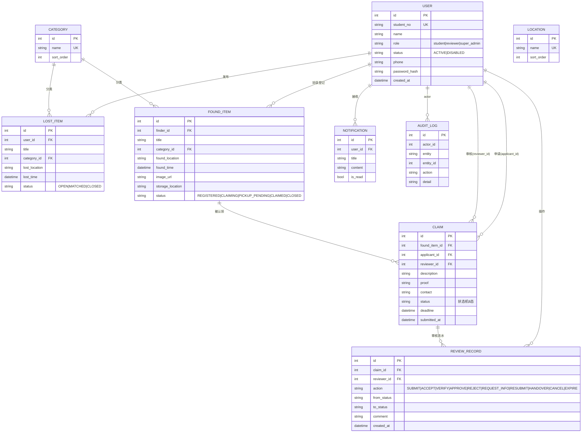

# 设计模型 01 — ER 图（实体关系，v1 · 9 实体）

> 与 api-contract-v1.md §4 内嵌版同源；字段级定义以契约 §2 为准（含非空/默认值列）。

要点：
- USER 与 CLAIM 存在两条关系（申请人 / 审核员），用两个外键区分。
- CATEGORY/LOCATION 为 v1 新增字典表；location 以地点字典维护为主，单据上冗余存文本便于检索。
- CLAIM↔REVIEW_RECORD 是"当前态 + 流水"组合：回放 REVIEW_RECORD 可重建任意 claim 的状态历史（含 VERIFY 核验记录）。
- AUDIT_LOG 由 C 端"日志查询"消费（UC-21）。
