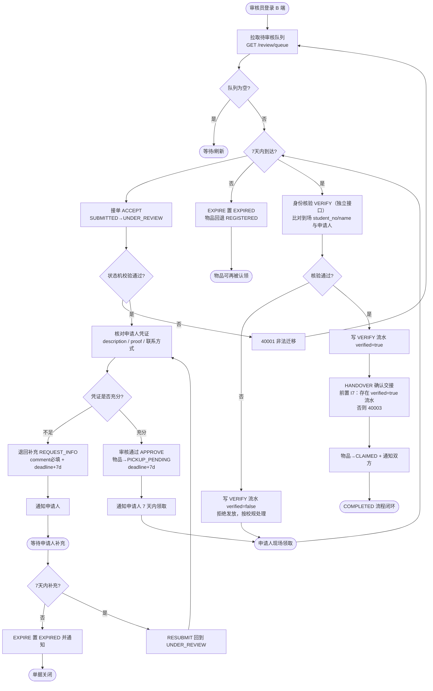

# 设计模型 05 — 流程图（B 端审核处理流程，v1）

> v1：`admin`→`reviewer`；"核验身份"升级为独立接口 VERIFY，并作为交接的强制前置（I7）。

异常出口：
- 申请人中途撤销 → CANCELLED（非终态任意点均可触发，物品回退 REGISTERED）。
- 认领被驳回 → REJECTED，物品保持可被其他认领单推进。
- 身份核验不通过 → 记录在案（流水 verified=false），不得交接，防冒领。
- 任何非法迁移 → 40001，界面提示"该单据当前状态不支持此操作"（前端按钮置灰数据源 = allowed_events）。
