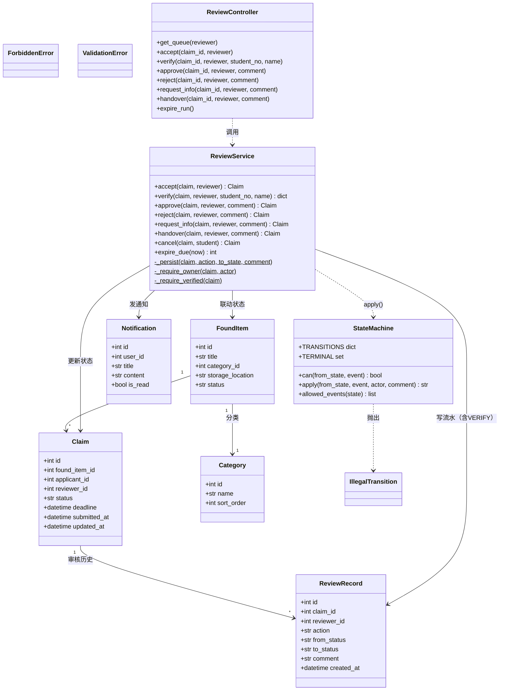

# 设计模型 06 — 类图（B 端审核模块实现结构，v1）

> v1：角色 `admin`→`reviewer`，ReviewService 新增 `verify()`（身份核验，自环写流水），handover 增加 I7 前置检查。

职责边界：
- `StateMachine`：纯函数式，不碰数据库，只回答"这条边存不存在、谁可触发"；VERIFY 是自环不改状态，因此不进迁移表，由 ReviewService 直接写流水。
- `ReviewService`：事务边界——落库、联动物品状态、写流水、发通知、鉴权（reviewer 本人 + I7 核验前置）。
- `ReviewController`：只做参数与角色校验，异常映射到统一错误码。
