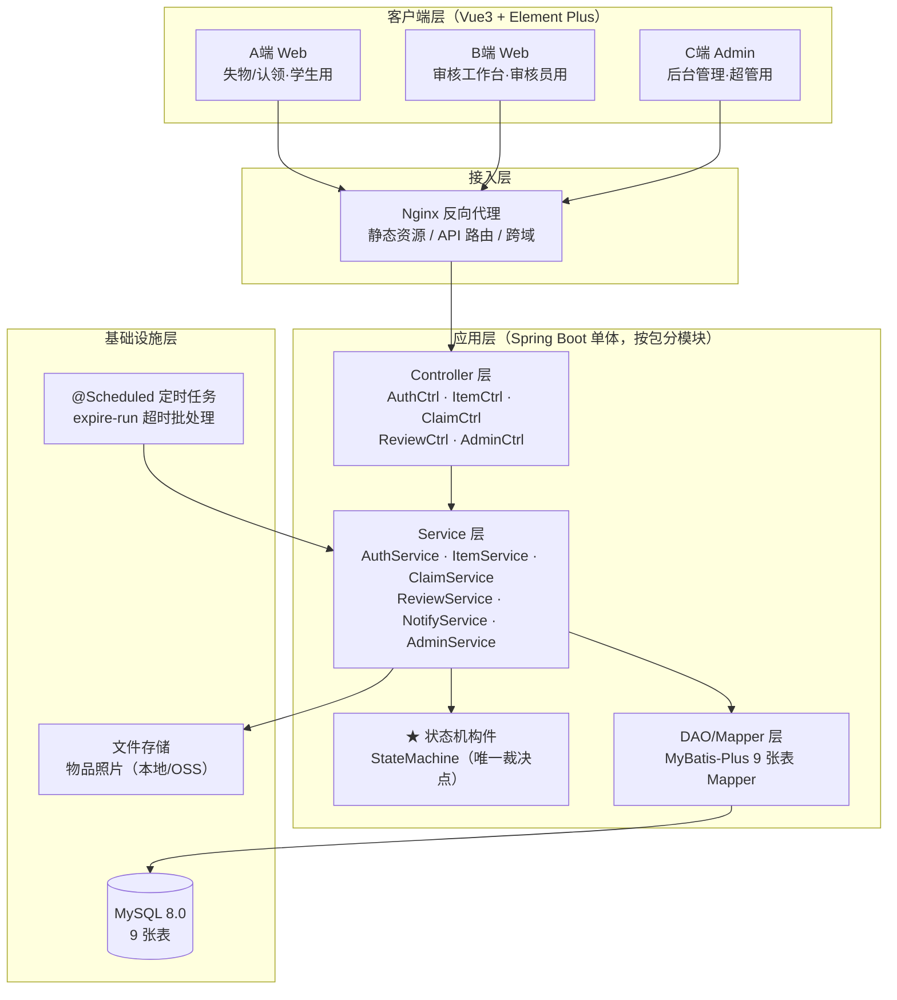

# 设计模型 07 — 体系结构图（评分表优秀档点名模型）

> 技术口径按全组约定：Vue3 + Spring Boot + MySQL。分层架构 + 三端入口。

体系结构说明（对应评分表"体系结构模型"）：
1. **表现层**：三个 Vue3 入口对应三角色（student/reviewer/super_admin），共用一套登录与通知组件。
2. **业务层**：Controller 只做参数校验与鉴权；Service 承载事务；**状态机为独立构件**，Service 通过它裁决迁移，禁止直接 UPDATE claim.status。
3. **数据层**：MyBatis-Plus 对应契约 9 张表。
4. **横切**：超时批处理为定时任务构件，调用与手动 expire-run 相同的 Service 入口。
