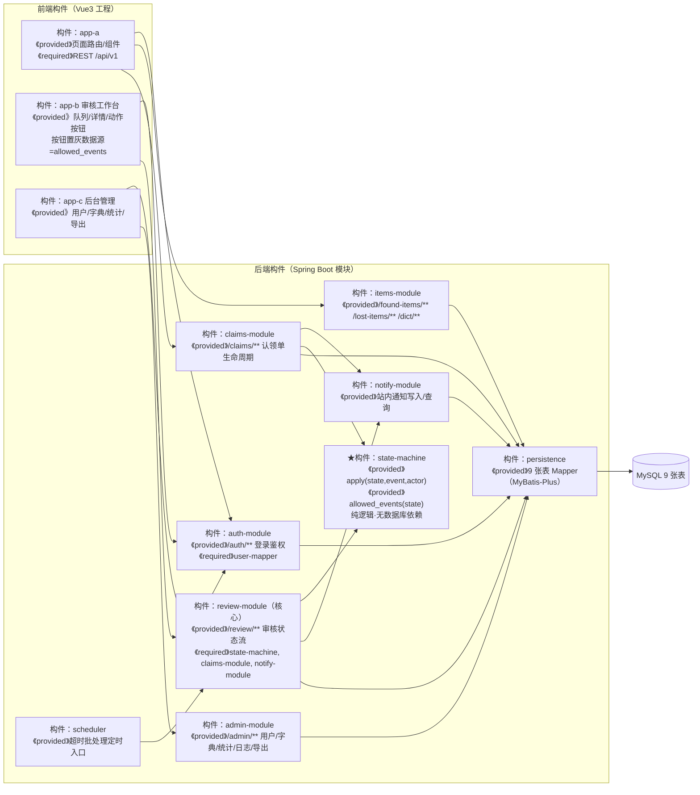

# 设计模型 08 — 构件图（评分表优秀档点名模型）

> 构件 = 可独立编译/部署、通过接口协作的单元。构件间只依赖接口（ provided / required ），与代码包一一对应。

构件设计要点：
1. **state-machine 是零依赖纯构件**：不 import 任何数据库/框架类，只提供 `apply()` 与 `allowed_events()`。这让 B 端工作台的"按钮置灰"能直接复用同一份迁移表，前端按钮与后端裁决天然一致。
2. **review-module 是唯一能触发迁移的构件**：claims-module 只能创建/查询/补充，approve/reject 等一律经 review-module。
3. **notify-module 解耦通知**：迁移的伴随动作通过它落通知，后续接短信/邮件只需换实现。
4. **scheduler 与手动 expire-run 复用同一 Service 入口**，答辩演示超时场景不用等定时器。
5. 与《接口-代码检查表》对应：FastAPI 原型中这 6 个后端构件即 main.py / service.py / state_machine.py / models.py 的职责划分，迁移到 Spring Boot 时按包一一对应。
