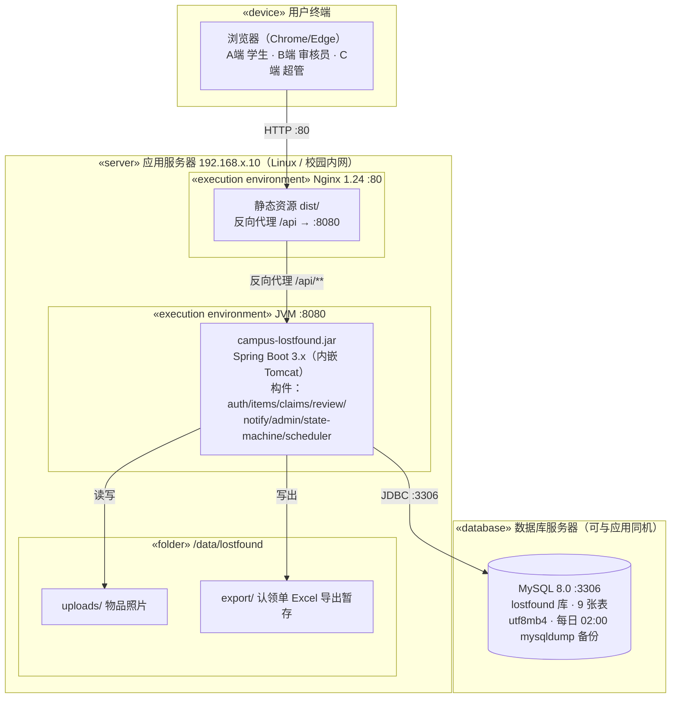

# 设计模型 09 — 部署图（评分表优秀档点名模型）

> 部署目标：校园内网单服务器（课程演示规模），按全组约定 Spring Boot 技术栈绘制。

部署说明：
| 项 | 方案 | 理由 |
|---|---|---|
| 前端 | `npm run build` 产出 dist/，由 Nginx 托管 | 三端共用域名不同路由（/admin/** 由 super_admin 角色守卫） |
| 后端 | Spring Boot fat-jar，`java -jar` + systemd 守护 | 单体足够，构件按包拆分，未来可拆微服务 |
| 数据库 | MySQL 8.0，9 张表，utf8mb4 | 全组约定；契约字段类型已按 MySQL 编写 |
| 文件 | 本地磁盘 /data/lostfound/uploads | 课程规模不引 OSS，路径存 found_item.image_url |
| 备份 | mysqldump 每日 02:00 | 审核流水与认领单是纠纷追溯依据，必须备份 |
| 安全 | 内网部署；B/C 端接口服务端强制角色校验 | 前端守卫仅是体验，权限以后端为准（对应不变量 I6） |

> 与原型对照：`server/`（FastAPI + SQLite）为**同构单机部署的演示保底**，打包为单目录即可运行，用于 D2 彩排与答辩现场；正式部署以上表 Spring Boot 方案为准。
