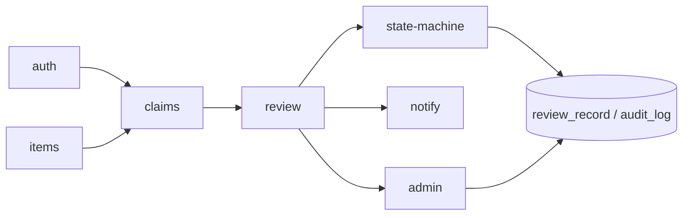
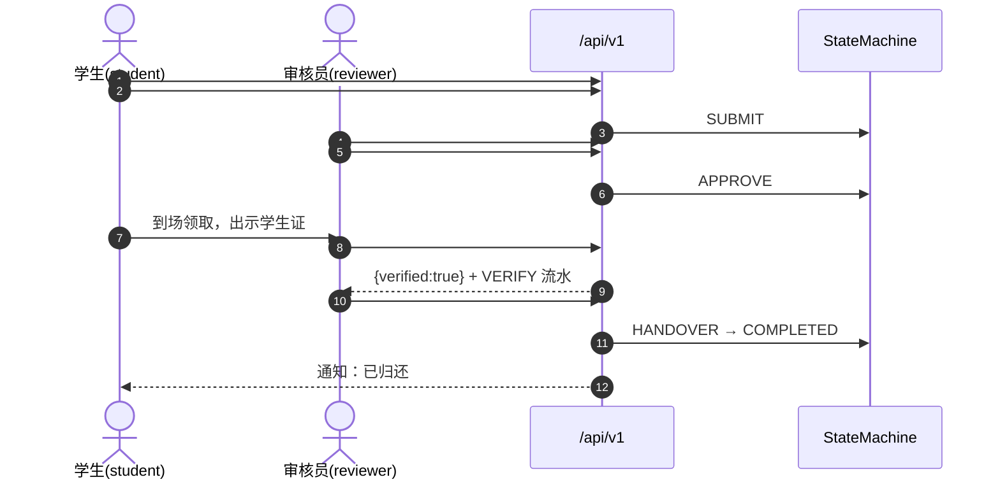

# 总体设计报告

| 项目 | 内容 |
|---|---|
| 课题 | 校园失物招领与认领审核系统（第 2 组） |
| 文档编号 | GDD-v1 |
| 版本 | v1（定稿，2026-11-04） |
| 负责人 | 阴亮（组长） |
| 依据 | 《需求说明书.md》《术语表-v1.md》《api-contract-v1.md》（已重新冻结）、李子研《设计说明书.md》v1.1 |
| 状态 | 6 份交付物之一 |

---

## 1 概述

### 1.1 编写目的

本文档从**全局视角**描述系统的总体结构、模块划分、核心流程、部署方案与技术路线，说明「需求如何被分解到三端与构件」「为什么这样分」，作为设计说明书、三端编码、测试与部署的共同上位文档。与李子研《设计说明书.md》的分工是：本文管**整体与结构**，设计说明书管**B 端审核模块的详细设计与实现**。

### 1.2 读者

课程评审教师、组长（终审）、设计负责人、三端开发、测试与演示负责人。

### 1.3 范围

覆盖 A 学生端、B 审核端、C 后台管理端，单工程、前后端分离、RBAC 三角色；不含悬赏支付、物流配送、真实统一身份认证、生物识别（见《需求说明书.md》§1.2）。

---

## 2 设计目标与约束

| 类型 | 内容 |
|---|---|
| 功能目标 | 主流程 7 步闭环；A/B/C 三端功能齐备；「身份核验 + 审核结论 + 操作留痕」构成课题亮点 |
| 首要设计目标 | **防冒领**：任何认领必须经过独立身份核验接口且有流水记录，交接前强制校验（不变量 I7） |
| 工期约束 | 3 天课程设计；允许 AI 辅助；批次 0 五人并行、契约前置，先出文件再对接 |
| 技术约束 | 正式栈 Vue3 + Spring Boot 3 + MyBatis-Plus + MySQL 8 + Nginx；表名/字段 `snake_case`；接口 `/api/v1` |
| 双轨约束 | 正式方案为 Vue3 + Spring Boot 3 + MySQL 8；**`05_源码/` 是正式源码交付物**，其可运行主体为同构 FastAPI 审核状态流原型（24 项冒烟两次全绿），构件与正式方案一一对应，可直接平移；`02-李子研/server/` 为同源开发副本 |
| 协作约束 | 契约 v1 已重新冻结；变更四步法、编号与格式统一见《全组约定与编号总则-v1.md》§2 / §5；Git 仓库已建立并同步，提交规范见总则 §6 |
| 质量约束 | 术语全文一致（以《术语表-v1》为准）、图统一 Mermaid、每条 FR 可测可演示 |

---

## 3 系统总体结构

### 3.1 逻辑结构

```mermaid
flowchart TB
  subgraph Client[前端 · Vue3 单工程三入口]
    A[A 学生端<br/>student]
    B[B 审核端<br/>reviewer]
    C[C 后台管理端<br/>super_admin]
  end
  A --> N[Nginx 反向代理 / 静态资源]
  B --> N
  C --> N
  N --> API[REST /api/v1 · 30 条]
  subgraph Server[Spring Boot 单体 · 按包分构件]
    API --> CTRL[Controller 层<br/>Auth/Item/Claim/Review/Admin]
    CTRL --> SVC[Service 层 · 事务边界]
    SVC --> SM[★ StateMachine 构件<br/>唯一合法迁移裁决点]
    SVC --> MAP[MyBatis-Plus Mapper]
  end
  MAP --> DB[(MySQL 8.0 · 9 张表)]
  SVC --> LOG[(audit_log / review_record 留痕)]
  SVC --> JOB[@Scheduled 超时批处理 EXPIRE]
```

**图 3-1　系统逻辑结构（三端 + 分层 + 单一裁决点）**

三端共享同一套后端与数据库，仅由 RBAC 决定可见菜单与可执行接口，不拆三个独立系统。

### 3.2 技术架构与分层约束

| 层 | 职责 | 禁止 |
|---|---|---|
| Controller | 参数校验、鉴权、统一返回 `{code,message,data}` | 直接写 `claim.status` |
| Service | 业务编排与事务边界 | 绕过状态机自行判定迁移 |
| **StateMachine** | 迁移表裁决、非法迁移抛 `40001`、提供 `allowed_events` 供前端按钮置灰 | 依赖数据库 |
| Mapper | 9 张表持久化 | 承载业务规则 |

> 全系统**只有一处**能改变认领单状态；每次迁移必须写一条 `review_record`（不变量 I2），关键动作双写 `audit_log`。这是「可追溯」这一质量属性的结构性保证。

### 3.3 权限模型（RBAC）

| 角色 | 可见端 | 允许接口 | 明确禁止 |
|---|---|---|---|
| `student` | A | #1-16（认证、字典、物品、认领、补充、撤销、通知） | 访问 `/review/**` 与 `/admin/**` |
| `reviewer` | B | #17-24（队列、接单、核验、通过/驳回/退补、交接、超时） | 用户与字典维护、统计导出；不得代替超级管理员作审核结论 |
| `super_admin` | C | #25-30（用户管理、字典维护、统计、日志、导出） | 代替审核员下审核结论（权责分离） |

越权统一返回 `40002`；未登录 `40101`；`#18/#20/#22/#23/#19` 还须校验「已接单 reviewer 本人」（不变量 I6）。

---

## 4 子系统与模块划分

| 构件 | 职责 | 主要接口 # | 实现归属 |
|---|---|---|---|
| `auth-module` | 注册、登录、token、账号启停 | 1-3、25-26 | 金道轩 / 邓昌兴 |
| `items-module` | 拾获登记、失物启事、字典读取、搜索 | 5-11、27-28 | 金道轩 / 邓昌兴 |
| `claims-module` | 认领申请提交、查询、补充、撤销 | 12-16 | 金道轩 / 邓昌兴 |
| **`review-module`** | **审核队列、接单、身份核验、通过/驳回/退补、交接、超时** | **17-24** | **李子研（原型已实现）** |
| `state-machine` | 迁移表裁决、终态封闭、I1-I7 不变量 | 被 review-module 调用 | 李子研 |
| `notify-module` | 站内通知生成与查询 | 4 | 共用 |
| `admin-module` | 用户与字典维护、统计看板、日志、Excel 导出 | 25-30 | 欧阳昊天 |



**图 4-1　构件依赖（箭头表示调用方向）**

依赖关系单向、无环：`state-machine` 为纯构件，不依赖数据库与任何业务模块，因而可独立测试（24 项冒烟测试中状态机相关用例即基于此）。

---

## 5 核心业务流程设计

### 5.1 主流程（7 步，按契约 v1 顺序）

| 步 | 环节 | 端 / 角色 | 接口 # | 状态变化 | 留痕 |
|---|---|---|---|---|---|
| 1 | 发布招领/失物登记 | A / student | 9 / 11 | `found_item=REGISTERED` | audit_log |
| 2 | 搜索浏览、查看详情（脱敏） | A / student | 7 / 8 / 10 | — | — |
| 3 | 提交认领申请（`proof` 必填） | A / student | 12 | `claim=SUBMITTED`；物品→`CLAIMING` | review_record |
| 4 | 接单 | B / reviewer | 18 | `SUBMITTED→UNDER_REVIEW`，锁定 reviewer | review_record |
| 5 | 审核通过 / 驳回 / 退补 | B / reviewer | 20 / 21 / 22 | →`APPROVED` / `REJECTED` / `PENDING_INFO`；物品→`PICKUP_PENDING` 或回退 `REGISTERED` | review_record + 通知 |
| 6 | **身份核验**（到场后核对学号姓名） | B / reviewer | **19** | **`APPROVED` 自环，不改状态** | VERIFY 流水 |
| 7 | 线下归还确认 + 归档 | B / reviewer | 23 | `APPROVED→COMPLETED`；物品→`CLAIMED` | review_record + 通知双方 |

> **关键顺序**：身份核验在**审核通过之后、交接之前**，不是审核前的一步。交接接口 #23 强制校验 I7——无 VERIFY 通过流水返回 `40003`。这是本课题区别于普通公告板的核心设计。



**图 5-1　主流程时序（含独立身份核验与 I7 前置）**

### 5.2 状态流与异常收敛

8 态 12 条合法迁移、4 个终态封闭（I1）、非法迁移 `40001`、驳回/退补必填意见（I5）、越权 `40002`、参数 `40003`。`PENDING_INFO` 与 `APPROVED` 携带 `deadline`（+7 天），由 `@Scheduled` 批处理 #24 统一收敛到 `EXPIRED`，物品回退 `REGISTERED` 后可被他人再认领，避免长期挂起与死锁。完整迁移表与状态机图见《api-contract-v1.md》§5。

---

## 6 部署结构

| 项 | 正式环境 | 原型（演示保底） |
|---|---|---|
| 前端 | Vue3 + Vite 构建，Nginx 托管，`:5173`（开发）/ `:80`（演示） | — |
| 后端 | Spring Boot 3 + JDK 17，`:8080/api/v1` | FastAPI + uvicorn，`:8000/api/v1` |
| 数据库 | MySQL 8.0，库 `lost_found`，utf8mb4 | SQLite 单文件 `lostfound.db` |
| 定时任务 | `@Scheduled` 扫 `deadline` | `POST /review/expire-run` 手动触发（便于演示） |
| 演示账号 | 三类角色各一 | `reviewer001` / `stu001` / `stu002` / `super001`，口令 `123456` |

原型与正式方案的构件一一映射（`state_machine.py`↔state-machine 构件、`service.py`↔review-module、`main.py`↔Controller 层），迁移路径见《接口-代码检查表》§五；详细部署模型见《设计模型/09-部署图.md》。

---

## 7 技术路线与选型依据

| 决策 | 备选 | 理由 |
|---|---|---|
| 单工程 + RBAC 三端 | 三个独立前端工程 | 三天工期内避免三套构建与联调；权限集中、术语统一 |
| 前后端分离 + REST | 服务端渲染 | 三端复用同一套接口；测试用例可脱离页面直接验接口 |
| 状态机迁移表集中裁决 | if-else 散落路由 | 8 态 12 迁移可枚举、可测；从机制上杜绝「驳回后再通过」脏路径 |
| 当前态 + 流水表分离 | 只存当前状态 | 可回放完整审核历史，答辩可举证 |
| MySQL + MyBatis-Plus | 全内存 / 文件 | 与课程技术栈一致；9 张表外键与索引有落点 |
| 双轨保留 FastAPI 原型 | 直接删除原型 | 24 项冒烟全绿，为 D2 彩排与答辩提供可跑的保底系统 |

---

## 8 质量属性

| 属性 | 设计手段 | 验证方式 |
|---|---|---|
| 安全性 | RBAC 三角色、越权 40002、口令哈希、特征描述列表脱敏、独立身份核验 + I7 | TC-PERM 系列、24 项冒烟 |
| 可追溯性 | 每次迁移写 `review_record`，关键动作双写 `audit_log`，C 端 #30 可查可导出 | `GET /claims/{id}` 返回完整流水 |
| 一致性 | 物品状态与认领单状态在同一事务内联动；单一裁决点 | TC-DATA 系列断言两张表 + 一条流水 |
| 健壮性 | 非法迁移、重复接单、重复申请、超长字段、上传失败均有明确错误码 | 错误码 5 类全覆盖 |
| 可维护性 | 分层 + 纯状态机构件；契约冻结 + 术语表统一；图全部 Mermaid 文本化 | 交叉材料 5 份 |
| 可演示性 | 种子数据预置 3 张不同状态单据；超时批处理可手动触发 | 演示脚本 15 步 / 现场 7 步 |

---

## 9 风险与应对

| # | 风险 | 影响 | 应对 |
|---|---|---|---|
| R1 | 冒领 | 高 | 独立核验接口 #19 + I7 + 特征脱敏 + 留痕 |
| R2 | 隐私泄露 | 高 | 列表页脱敏，完整特征仅审核端可见 |
| R3 | 契约冻结后被修改 | 高 | 群里声明 + 记入情况记录表；改动集中一轮完成 |
| R4 | 三端联调崩 | 高 | 保 P0 主流程 A+B+归还；C 端统计降级；原型作演示保底 |
| R5 | 工期 3 天 | 中 | 五人并行、契约前置、AI 辅助、每日 22:00 收文件清单 |
| R6 | AI 生成文档本人未通读 | 中 | 批次 2 每人通读主责文档并确认，答辩按分工点名 |
| R7 | 并发抢单 | 中 | 接单用状态条件更新，重复接单返回 40001 |
| R8 | C 端接口字段未细化 | 低 | 契约 v1 §8 约定由欧阳昊天在《接口文档》C 端分册补齐后并入 |

---

## 10 与需求的对应

| 需求侧 | 设计侧 | 追踪材料 |
|---|---|---|
| FR-01~07（A 端） | auth / items / claims / notify 构件，接口 #1-16 | 《需求-设计对照表》 |
| FR-08~12（B 端） | review-module + state-machine，接口 #17-24 | 《需求-设计对照表》、24 项冒烟记录 |
| FR-13~16（C 端） | admin-module，接口 #25-30 | 契约 v1 §7 三端功能↔接口对照表 |
| 需求 4 图 | 用例图（阴亮）、顺序图 / 分析类图 / 状态图（`04_图表与交叉材料/`） | 《需求说明书.md》附录 A |
| 设计 6 模型 | 体系结构 / 构件 / 用例 / 类界面 / 数据 / 部署，共 9 张 | `02-李子研/设计模型/01~09` |

> 每条 FR 均可追到接口编号与测试用例；FR-15（公告）为 P2 遗留需求，v1 契约未提供接口，本版不实现，已明示范围，不作为缺陷。

---

## 附录 A　图表索引

| 图号 | 名称 | 位置 |
|---|---|---|
| 图 3-1 | 系统逻辑结构 | 本文 §3.1 |
| 图 4-1 | 构件依赖 | 本文 §4 |
| 图 5-1 | 主流程时序 | 本文 §5.1 |
| — | ER 图 / 状态机图 | `api-contract-v1.md` §4 / §5（内嵌，同源为准） |
| — | 9 张设计模型 | `02-李子研/设计模型/01~09` |

## 附录 B　修订记录

| 版本 | 日期 | 修改人 | 说明 |
|---|---|---|---|
| **v1** | **2026-11-04** | **阴亮** | **按 `api-contract-v1.md` 定稿：三角色 RBAC、9 构件、30 接口、独立身份核验与 I7、双轨部署、8 态状态流** |
| v1 修订 | 2026-11-04 | 阴亮 | 约定条款收拢至《全组约定与编号总则-v1.md》，修正「Git 暂缓」「原型不作正式交付源码」等与现状冲突的表述；技术口径未变，不升版本号 |
