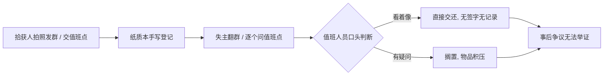
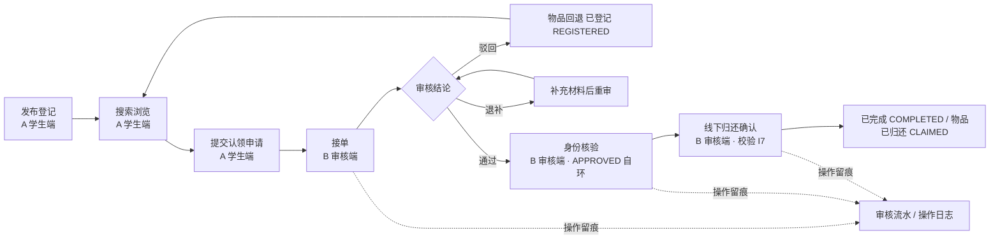

# 软件需求规格说明书（前两章）

| 项目 | 内容 |
|---|---|
| 课题 | 校园失物招领与认领审核系统（第 2 组） |
| 文档编号 | SRS-v1 |
| 版本 | **v1 定稿**（2026-11-04） |
| 负责人 | 阴亮 |
| 日期 | 2026-11-04 |
| 状态 | **已定稿**；以 `api-contract-v1.md`（已重新冻结）为唯一口径 |
| 编制依据 | GB/T 8567《计算机软件文档编制规范》SRS 结构（课程设计裁剪版）、《全员任务总清单》、李子研《api-contract-v1.md》、《术语表-v1.md》 |

> 本文为完整定稿（第 1–6 章 + 附录），由批次 0 前两章按 `api-contract-v1.md` 补全而成。全文术语以《术语表-v1.md》为准；`admin` 代号已废弃。

---

## 1 引言

### 1.1 编写目的

本文档描述「校园失物招领与认领审核系统」的业务问题、用户、范围与需求规定，作为本组 3 天课程设计的**唯一需求基线**，供以下对象使用：

| 读者 | 用途 |
|---|---|
| 组长（阴亮） | 组织分工、批次 2 术语对齐、全套材料终审 |
| 设计负责人（李子研） | 编写设计说明书、9 种设计模型、ER 图与状态机、接口契约 v1 |
| 开发（邓昌兴 / 金道轩 / 李子研 / 欧阳昊天） | 按需求搭三端骨架、写 A/B/C 端代码 |
| 测试与演示（欧阳昊天 / 金道轩） | 逐条写测试用例表、15 步演示脚本、答辩题库 |
| 课程评审教师 | 核对需求分析与需求模型评分项 |

本文档同时是批次 2《需求—设计对照表》《需求—演示对照表》的左侧基准。

### 1.2 范围

**系统名称**：校园失物招领与认领审核系统。

**要做的**：以「物品」台账为主体，把校园内拾获登记、失物登记、搜索浏览、认领申请、**身份核验**、**审核通过/驳回**、线下归还确认、归档串成一条可追溯的闭环；用 RBAC 区分 A 学生端、B 审核端、C 后台管理端；对审核与归还等关键动作操作留痕。

**不做的（明确边界，防止范围蔓延）**：

| 不做 | 原因 |
|---|---|
| 悬赏、酬金、在线支付 | 涉及资金与合规，超出课程设计范围 |
| 物流配送、快递取件 | 归还采用线下面对面交接 |
| 接入校园一卡通 / 统一身份认证真实接口 | 演示环境用学号 + 模拟身份核验 |
| 人脸识别、证件 OCR 自动鉴别 | 身份核验由审核员人工核对材料完成 |
| 跨校区多租户、移动端原生 App | 单校区、单工程、Web 三端 |
| 自动匹配推送失主 | 本版由学生主动搜索，不做智能推荐 |

**三端范围**（与接口契约 v1 一致）：

| 端 | 主要能力 |
|---|---|
| A 学生端 | 注册登录、发布失物/招领登记（含图片）、按分类/地点/时间搜索筛选、查看物品详情、提交认领申请、查看我的申请与消息通知 |
| B 审核端 | 认领申请列表、身份核验、审核通过/驳回、物品状态流转、争议处理、操作留痕 |
| C 后台管理端 | 用户管理、分类/地点字典维护、公告、数据统计看板、操作日志查询、Excel 导出 |

### 1.3 定义、缩写与术语

全文术语见《术语表-v1.md》，此处仅列高频项：

| 术语 | 本文含义 |
|---|---|
| 物品 | 一条拾获/招领登记对应的实物台账记录，状态流转的主体 |
| 认领申请 | 失主对某件物品提出认领并接受核验、审核的单据 |
| 身份核验 | 审核员在**审核通过后、交接前**核对到场人学号姓名；独立接口、不改状态、写流水（I7） |
| 审核员 | B 审核端执行身份核验与审核的角色 |
| 三端 | A 学生端 / B 审核端 / C 后台管理端，单工程内按 RBAC 区分 |
| 主流程 | 发布登记 → 搜索浏览 → 提交认领申请 → 接单 → 审核通过/驳回 → **身份核验** → 线下归还确认 → 物品归档 |

缩略语：SRS（需求规格说明书）、RBAC（基于角色的访问控制）、FR（功能需求，编号 `FR-xx`）、UC（用例）、GB/T 8567（《计算机软件文档编制规范》）。

### 1.4 参考资料

1. GB/T 8567—2006《计算机软件文档编制规范》
2. GB/T 9385《计算机软件需求规格说明规范》
3. 软件工程课程设计任务书与评分表（需求分析 30、需求模型 30、设计规格 20、设计模型 30、编码 100、软件测试 25、演示 20、团队协作 10、回答问题 10、PPT 50 等）
4. 本组《全员任务总清单—先产出后对接》
5. 李子研《api-contract-v1.md》（数据字典与接口契约，**已重新冻结，本文档唯一口径依据**）
6. 《总体设计报告.md》§3/§6、李子研《设计说明书.md》v1.1 附录 A（正式技术栈与双轨原型）
7. 《术语表-v1.md》、《全组约定与编号总则-v1.md》、《用例图.md》、《测试用例表.md》、《演示脚本-v0.md》（文件名带 v0，仍为现行 15 步依据，见总则 §6）

### 1.5 文档约定

- 需求编号 `FR-xx`，按三端分组；每条需求必须**可测试、可演示**。
- 优先级：`P0` 主流程必通（彩跑项）、`P1` 重要、`P2` 有余力再做。
- **编号空间（`UC-xx` / `#N` / `TC-xxx` / `步 N` / `DEP-x`）、文档格式、图题表题、引用写法、定稿禁用项、口径变更与提交流程，统一见《全组约定与编号总则-v1.md》§2 / §4 / §5 / §7**，本处不重复维护。
- 本次交付为完整定稿，全文无未完成项。

---

## 2 任务概述

### 2.1 问题定义与实际意义

#### 2.1.1 现状：失物招领靠「群 + 本子」

目前校园内遗失与拾获物品主要靠三种 informal 渠道：朋友圈/表白墙/微信群转发、各楼栋值班点的纸质登记本、同学之间口头相传。这些渠道能勉强「传消息」，但**没有流程、没有审核、没有留痕**，一旦涉及证件、钥匙、手机等高价值物品，问题立刻暴露。

#### 2.1.2 真实用户与痛点

> 系统的真实用户不是抽象的「用户」，而是下面 5 类具体的人；痛点必须落到他们各自的一次具体操作上。

| # | 真实用户 | 典型场景 | 现在怎么做 | 具体痛点 | 系统对应能力 |
|---|---|---|---|---|---|
| U1 | **拾获物品的学生**（拾获人） | 在食堂捡到一张校园卡/一串钥匙 | 拍照发群、或交到值班点让工作人员记在本子上 | 不知道该交给谁、登记内容全凭手写；发出去后无人跟进，物品长期堆在抽屉；「我明明交上去了」无凭据 | 发布招领登记（分类/地点/时间/图片/保管点），状态可查，操作留痕 |
| U2 | **丢失物品的学生**（失主） | 丢了学生证/耳机，第二天要考试 | 翻十几个群、逐个问值班点、在表白墙刷屏 | 信息分散、检索只能靠关键词和时间线；无法按地点/时间/分类筛；看到帖子也不知道东西还在不在 | 按分类/地点/时间搜索筛选、查看物品状态与详情、在线提交认领申请 |
| U3 | **审核员**（失物招领处值班老师 / 学生助理 / 保卫处值守） | 有人来认领一部手机 | 凭口述与肉眼判断，偶尔看一下学生证，纸质本上签个字 | **冒领风险最高的一环**：无身份核验标准、无审核结论记录；多人认领同一物品时无争议处理依据；交接后出问题无法举证 | B 审核端：申请列表、身份核验、审核通过/驳回、争议处理、审核记录与操作日志 |
| U4 | **超级管理员**（后台管理） | 学期末要统计招领成效、清理字典 | 翻纸质本、手工汇总 Excel | 分类/地点叫法不统一；无统计数据、无日志查询；公告无处发布 | C 后台端：用户与字典维护、公告、统计看板、操作日志查询、Excel 导出 |
| U5 | **院系/辅导员**（外部干系人，不设系统角色） | 学生来开遗失证明、投诉冒领 | 电话追问值班点 | 缺少可追溯凭据，纠纷处理周期长 | 从操作日志与归还记录导出凭证 |

#### 2.1.3 问题归因

把上表收敛成三个可设计的根因：

| 根因 | 表现 | 设计对策 |
|---|---|---|
| **信息无结构** | 帖子、纸质本各自为政，无分类/地点/时间/状态字段 | 建立统一「物品」台账 + 分类/地点字典 |
| **流程无闭环** | 发布之后没有申请、核验、审核、归还、归档的状态概念 | 引入物品状态机与认领申请状态；驳回 / 撤销 / 超期后物品回退 `REGISTERED`，可被他人再认领 |
| **权责无留痕** | 谁核验、谁批准、谁领走，全靠记忆 | 审核记录 + 归还记录 + 操作日志，RBAC 限定动作权限 |

其中「**认领审核**」是本课题区别于普通失物招领公告板的关键：不是谁先说东西是自己的就给谁，而是**身份核验 + 审核结论 + 留痕**三件事一起构成可追责的闭环。

#### 2.1.4 实际意义

| 层面 | 意义 | 可度量目标（建议值，批次 1 与测试组确认） |
|---|---|---|
| 对学生 | 丢失后一个入口检索，认领进度可见，减少刷群与跑腿 | 检索到目标物品 ≤ 3 次筛选；申请提交后状态实时可见 |
| 对管理方 | 冒领有核验、审核有结论、交接有记录，纠纷可举证 | 关键动作留痕率 100%；认领申请审核时限 ≤ 1 个工作日 |
| 对物品保管 | 状态与保管点清晰，超期归档，避免长期积压 | 每件物品状态唯一且可追踪；已归还/已归档可追溯 |
| 对课程实践 | 完整走一遍需求→设计→编码→测试→演示→答辩，产出 6 份材料与可运行三端系统 | 主流程彩排一次跑通；FR 全部被 TC 与演示步骤覆盖 |
| 对团队协作 | 5 人并行、先出东西再对接，契约驱动，过程记录可查 | 情况记录表逐日填写；术语对齐零残留 |

> 目标值为**建议**，不是承诺；批次 2 交叉对照时按实际实现修订。

### 2.2 业务背景

#### 2.2.1 场景特征

- 物品类别集中：证件（学生证、身份证、校园卡）、电子设备（手机、耳机、U 盘）、钥匙、书本、衣物、其他。
- 高发地点集中：食堂、教学楼、图书馆、宿舍楼、运动场；拾获后通常交至就近保管点。
- 时间敏感：证件类直接影响考试、门禁、出行；失主往往在数小时内主动寻找。
- **特征信息敏感**：物品的颜色、刻字、内含物、锁屏壁纸等是判断归属的关键证据，若在公开列表页全文展示，等于给冒领者提供答案。因此特征描述需分级可见（列表脱敏、审核端可见），列为安全需求（批次 1 §3.5）。

#### 2.2.2 现状流程（As-Is）

**图 2-1　现状失物招领流程（无审核、无留痕）**

现状的断点在 D：判断依据、判断人、判断结论三者都没有被系统记录。

#### 2.2.3 目标流程（To-Be，与接口契约 v1 一致）

**图 2-2　目标主流程（7 步闭环）**

物品状态：`REGISTERED`（已登记）→ `CLAIMING`（认领中）→ `PICKUP_PENDING`（待领取）→ `CLAIMED`（已归还）→ `CLOSED`（已归档）；驳回 / 撤销 / 超期均回退 `REGISTERED`（枚举以契约 v1 §5 为准）。

#### 2.2.4 业务规则与风险

| 编号 | 规则 / 风险 | 要求 |
|---|---|---|
| BR-01 | 冒领 | 认领必须经过审核结论 + 独立身份核验（审核通过后、交接前），禁止自动放行 |
| BR-02 | 特征泄露 | 公开列表页不展示完整特征描述 |
| BR-03 | 多人认领同一物品 | 支持争议处理，一个物品同时仅有一条有效审核流 |
| BR-04 | 驳回后无人再领 | 驳回回退 `REGISTERED`，物品重新可搜索 |
| BR-05 | 长期无人认领 | `deadline` +7 天超时由定时任务置 `EXPIRED`，物品回退 `REGISTERED`（弃用「公示期」） |
| BR-06 | 交接纠纷 | 归还确认必须留痕，含领取人、核验人、时间 |
| BR-07 | 权限越界 | 学生不得执行审核；身份核验、审核仅审核员可做 |

### 2.3 建设目标与约束

| 类型 | 内容 |
|---|---|
| 功能目标 | 跑通主流程 7 步；A/B/C 三端各自功能齐备；审核与留痕为亮点 |
| 技术约束 | Vue3 + Spring Boot 3 + MyBatis-Plus + MySQL 8，单工程、前后端分离、RBAC 三端；表名/字段名 snake_case，接口 `/api/v1` 前缀；FastAPI + SQLite 仅作演示保底原型 |
| 工期约束 | **3 天**；允许使用 AI；批次 0 全部并行、不等契约 |
| 协作约束 | 先各自出文件再对接；口径变更按《全组约定与编号总则-v1.md》§5 四步法执行；Git 仓库已建立并同步，提交规范见总则 §6 |
| 质量约束 | 术语全文一致；图统一 Mermaid；需求可测试、可演示；每人通读自己主责文档 |
| 环境约束 | 演示在课程设计本机环境运行，使用模拟演示账号，不接真实统一身份认证 |

### 2.4 用户与角色

| 角色 | 端 | 核心权限 | 禁止 |
|---|---|---|---|
| 学生 | A 学生端 | 发布登记、搜索、提交认领申请、查看自己的申请与消息 | 审核、核验、查看他人完整特征描述、用户管理 |
| 审核员 | B 审核端 | 查看申请与完整特征、身份核验、审核通过/驳回、争议处理、归还确认 | 用户管理、字典维护、统计导出 |
| 超级管理员 | C 后台管理端 | 用户管理、分类/地点字典、公告、统计看板、操作日志、Excel 导出 | 代替审核员作审核结论（避免权责混淆） |

### 2.5 假定与依赖

| 依赖号 | 假定 / 依赖 | 影响 | 责任人与时点 |
|---|---|---|---|
| DEP-1 | 李子研《api-contract-v1.md》定义 9 张表字段（NN/DEF）、8 态状态机、30 条接口 | 第 3 章数据需求、设计说明书、三端代码、测试用例全部依赖它 | 李子研，已交付并重新冻结 |
| DEP-2 | 正式技术栈 Vue3 + Spring Boot 3 + MySQL 8，原型 FastAPI + SQLite | 第 4 章运行环境 | 契约 v1 与《总体设计报告》已确认 |
| DEP-3 | 统一格式规范与排版模板 | 全套材料排版 | 欧阳昊天，批次 3 终审前统一 |
| DEP-4 | 演示环境可准备三类角色账号与演示数据 | 15 步演示与彩排 | 金道轩 + 邓昌兴，批次 2 |
| DEP-5 | 线下归还由人工当面完成 | 系统只做「确认」不做物流 | 全组共识 |
| DEP-6 | 身份核验为人工核对，不做生物识别 | 安全需求边界 | 全组共识 |

> 编号说明：本节 `DEP-x` 为「假定与依赖」编号；演示脚本使用「步 N」，两者互不相干，不得混写。完整编号空间见《全组约定与编号总则-v1.md》§2。

---

## 3 需求规定

### 3.1 功能需求（FR-01 ~ FR-16）

> 每条需求均可测试、可演示；优先级 P0（主流程必通）/ P1（重要）/ P2（有余力再做）。接口编号 `api-contract-v1.md` §3，用例编号《用例图.md》UC-01~UC-21。

#### 3.1.1 A 学生端（student）

| 编号 | 需求名 | P | 需求描述（可测试） | UC | 接口 # | 验收方式 |
|---|---|---|---|---|---|---|
| FR-01 | 注册 / 登录 | P0 | 学号唯一注册；口令哈希存储；登录返回 token 与角色；未登录访问业务接口返回 40101；按角色进入对应端 | UC-01 | 1-3 | TC-AUTH-01~08；脚本步 1 |
| FR-02 | 发布招领登记 | P0 | 拾获人录入标题、分类、拾获地点/时间、特征描述、图片、保管点；提交后状态 `REGISTERED`；`finder_id` 可空（代登记） | UC-02 / UC-09 | 5, 9 | TC-FOUN步 1/05/08；步 2 |
| FR-03 | 发布失物登记 | P1 | 失主录入遗失信息并发布寻物启事；状态 `OPEN` | UC-03 | 10, 11 | TC-FOUND-06/07 |
| FR-04 | 搜索浏览物品 | P0 | 按分类 / 地点 / 关键词 / 时间筛选，支持分页；列表不展示完整特征描述 | UC-04 | 5-8, 10 | TC-FOUN步 2/03；步 4-5 |
| FR-05 | 查看物品详情 | P0 | 展示状态与**脱敏后**特征；不存在的 id 返回 40401；完整特征仅审核端可见 | UC-05 / UC-16 | 8 | TC-FOUN步 6；TC-PERM |
| FR-06 | 提交认领申请 | P0 | 对可认领物品提交申请，`proof`（凭证特征）必填；生成 `SUBMITTED` 单据，物品转 `CLAIMING`；同一人对同一物品不得存在未终结单据 | UC-06 / UC-08 | 12, 15, 16 | TC-CLAIM-01~10；步 6 |
| FR-07 | 查看我的申请与消息 | P1 | 只返回本人认领单及状态/审核流水；通知列表含已读标记 | UC-07 | 4, 13, 14 | TC-CLAIM-05/06/07 |

#### 3.1.2 B 审核端（reviewer）— 课题核心

| 编号 | 需求名 | P | 需求描述（可测试） | UC | 接口 # | 验收方式 |
|---|---|---|---|---|---|---|
| FR-08 | 认领申请列表与详情 | P0 | 待审核队列按提交时间升序；详情含完整 `review_record` 流水；学生访问返回 40002 | UC-10 | 17, 14 | TC-REV-01~04；步 8 |
| FR-09 | **身份核验** | P0 | 到场后核对学号姓名；**独立接口、不改认领单状态**，写 `VERIFY` 流水；核验不通过不得交接 | UC-11 | **19** | 冒烟第 3 组；步 12 |
| FR-10 | 审核通过 / 驳回 | P0 | 通过须已接单且为本人，物品转 `PICKUP_PENDING` 并设 7 天期限；驳回原因 `comment` 必填，物品回退 `REGISTERED` | UC-12 | 20, 21 | TC-REV-05~12；步 11 |
| FR-11 | 状态流转与争议处理 | P0 | 8 态 12 条合法迁移；终态封闭；退回补充后 `RESUBMIT` 回到审核中；多人认领时仅一条有效审核流 | UC-12 / UC-13 / UC-15 | 22, 15, 24 | TC-ST-01~13；冒烟 |
| FR-12 | 线下归还确认 + 留痕 | P0 | **交接前必须存在该单据 VERIFY 通过流水（I7）**，否则 40003；通过后 `COMPLETED`、物品 `CLAIMED`、通知双方 | UC-14 | 23 | 冒烟「未核验就交接」；步 13 |

#### 3.1.3 C 后台管理端（super_admin）

| 编号 | 需求名 | P | 需求描述（可测试） | UC | 接口 # | 验收方式 |
|---|---|---|---|---|---|---|
| FR-13 | 用户与角色管理 | P1 | 用户列表含角色与状态；可启用/停用账号；超级管理员**不得**代替审核员下审核结论 | UC-17 | 25, 26 | 24 项冒烟「超管访问队列应 40002」 |
| FR-14 | 分类 / 地点字典维护 | P1 | C 端读写字典，A/B 端下拉复用；名称唯一、可排序 | UC-18 | 27, 28 | 冒烟第 0 组「分类/地点字典」 |
| FR-15 | 公告发布 | **P2** | **本版不实现**：契约 v1 未提供公告接口（无 `notice` 表），列为遗留需求，不在演示与验收范围内 | UC-19 | — | 范围外，见 §1.2 |
| FR-16 | 统计看板 / 日志 / 导出 | P1 | 统计登记量、认领量、完成率、超时率；`audit_log` 可查询；认领单可导出 Excel | UC-20 / UC-21 | 29, 30 | 原型未含，演示第 15 步降级为「审核流水 + 通知中心」并口头交代 |

### 3.2 业务主流程

> **顺序以契约 v1 为准**：身份核验在**审核通过之后、交接之前**，是 `APPROVED` 自环、不改状态；交接接口强制校验 I7。v0 文档中「核验在审核前」的表述已作废。

| 步 | 环节 | 端 / 角色 | 接口 # | 状态变化 | 留痕 / 通知 |
|---|---|---|---|---|---|
| 1 | 发布登记 | A / student | 9 / 11 | `found_item=REGISTERED` | audit_log |
| 2 | 搜索浏览、查看详情（脱敏） | A / student | 7 / 8 / 10 | — | — |
| 3 | 提交认领申请 | A / student | 12 | `claim=SUBMITTED`；物品→`CLAIMING` | review_record + 通知 |
| 4 | 接单 | B / reviewer | 18 | →`UNDER_REVIEW`，锁定 reviewer | review_record |
| 5 | 审核通过 / 驳回 / 退补 | B / reviewer | 20 / 21 / 22 | →`APPROVED`/`REJECTED`/`PENDING_INFO` | review_record + 通知 |
| 6 | **身份核验** | B / reviewer | **19** | **`APPROVED` 自环，状态不变** | VERIFY 流水 |
| 7 | 线下归还确认 + 归档 | B / reviewer | 23 | →`COMPLETED`；物品→`CLAIMED` | review_record + 通知双方 |

异常与旁路：驳回 / 撤销 / 超期均使物品回退 `REGISTERED`，重新可被认领；`PENDING_INFO` 补充材料后 `RESUBMIT` 回 `UNDER_REVIEW`；`deadline`（+7 天）超时由定时任务 #24 统一收敛 `EXPIRED`。完整时序见《需求4图-补齐3张.md》图 3-1，状态图见图 3-3。

### 3.3 数据需求

- **9 张表**：`user`、`category`、`location`、`lost_item`、`found_item`、`claim`、`review_record`、`notification`、`audit_log`。字段、类型、非空（NN）、默认值（DEF）以 `api-contract-v1.md` §2 为准，不得自行增删。
- **ER 图**：契约 v1 §4 内嵌 9 实体关系图（同源展开版见《设计模型/01-ER图.md》），冲突时以契约为准。
- **状态枚举**：物品 5 态（`REGISTERED`/`CLAIMING`/`PICKUP_PENDING`/`CLAIMED`/`CLOSED`）；认领申请 8 态（`SUBMITTED`/`UNDER_REVIEW`/`PENDING_INFO`/`APPROVED`/`REJECTED`/`CANCELLED`/`COMPLETED`/`EXPIRED`）。
- **可追溯性**：`claim.status` 只存当前态，`review_record` 以流水记录每次迁移（含 `VERIFY`），两者互证可回放完整审核历史；关键动作双写 `audit_log`。
- **数据保留**：演示数据使用模拟账号，不接入真实统一身份认证；`deadline` 默认 7 天，弃用「公示期」一词。

### 3.4 性能需求

| # | 指标 | 目标值（课程演示环境） | 验证 |
|---|---|---|---|
| PF-01 | 列表 / 详情接口响应 | 单机 ≤ 1 s（演示数据量 ≤ 100 条） | 演示脚本计时 |
| PF-02 | 分页 | 默认 `size=10`，支持 `page`/`size`，返回 `total` | TC-FOUN步 2/03 |
| PF-03 | 并发接单 | 仅一名 reviewer 可接单，重复接单返回 40001，不覆盖他人 `reviewer_id` | 冒烟 / TC-DATA |
| PF-04 | 超时批处理 | 单次扫描可处理全部超期单据，返回失效数量与 id 列表 | 冒烟第 5 组 |
| PF-05 | 图片上传 | 单张 ≤ 2 MB，超长 URL 字段返回 40003 | TC-FOUN步 12 |
| PF-06 | 检索效率 | 按分类 / 地点 / 关键词筛选走索引，3 次筛选内定位目标物品 | §2.1.4 可度量目标 |

### 3.5 安全与隐私需求

| # | 需求 | 实现约束 |
|---|---|---|
| SEC-01 | RBAC 三角色 | `student` / `reviewer` / `super_admin`；越权统一 40002；`admin` 代号废弃 |
| SEC-02 | 特征描述脱敏 | 公开列表页不展示完整 `proof`/特征；完整信息仅 B 端审核员可见 |
| SEC-03 | 防冒领 | 认领必须经审核结论 + **独立身份核验接口 #19**，交接前强制校验 I7 |
| SEC-04 | 口令 | 哈希存储，响应体不含任何口令字段 |
| SEC-05 | 鉴权 | 除注册/登录外均需 `Authorization: Bearer <token>`；失效返回 40101 |
| SEC-06 | 权责分离 | 超级管理员不得代审核员作审核结论；审核员不得做用户/字典/统计操作 |
| SEC-07 | 留痕 | 审核、驳回、核验、交接、撤销、超期全部写流水与审计日志，可供纠纷举证 |

### 3.6 输入输出与接口需求

- 全部接口见 `api-contract-v1.md` §3：共 30 条（含读写拆分为 33 条），按 A/B/C 三端分组，每条含允许角色、关键参数、响应要点。
- 统一返回 `{code, message, data}`；失败含 `detail`。错误码：`0` 成功、`40001` 非法状态迁移、`40002` 无权限、`40003` 参数校验失败、`40401` 资源不存在、`40101` 未登录或 token 失效（契约 §6）。
- 字段级请求/响应示例、curl 验证见李子研《接口文档.md》；C 端 6 条接口的字段细化由欧阳昊天在《接口文档》C 端分册补齐后并入契约（契约 §8）。
- 输入校验：`proof` 必填、驳回与退补 `comment` 必填、补充材料非空、超长字段拒绝、重复申请拒绝。

### 3.7 故障处理与异常需求

| 场景 | 期望行为 | 错误码 | 对应测试 |
|---|---|---|---|
| 对终态单据再执行事件 | 拒绝迁移，返回可读原因 | 40001 | TC-ST 系列 |
| 重复接单 / 越权操作他人单据 | 拒绝，不覆盖 reviewer_id | 40001 / 40002 | TC-PERM |
| 驳回 / 退补未填原因 | 拒绝，不写流水 | 40003 | TC-REV |
| 交接前未身份核验 | 拒绝交接（I7） | 40003 | 冒烟第 3 组 |
| 重复提交认领申请 | 拒绝，物品状态不变 | 40003 | TC-CLAIM-03 |
| 查询不存在的单据 / 物品 | 返回资源不存在 | 40401 | TC-FOUN步 6 |
| 未登录 / token 失效 | 不返回业务数据 | 40101 | TC-AUTH-06/07 |
| 图片上传失败 / 超长字段 | 不落库，给出校验提示 | 40003 | TC-FOUN步 9/10/09 |
| 超期未补充 / 未领取 | 定时任务置 `EXPIRED`，物品回退 `REGISTERED`，通知申请人 | 0（批处理） | 冒烟第 5 组 |

---

## 4 运行环境规定

| 项 | 正式环境 | 原型（演示保底） |
|---|---|---|
| 前端 | Vue3 + Vite + Element Plus，Nginx 托管 | — |
| 后端 | Spring Boot 3 + JDK 17 + MyBatis-Plus，`:8080/api/v1` | FastAPI + uvicorn，`:8000/api/v1` |
| 数据库 | MySQL 8.0，库 `lost_found`，utf8mb4 | SQLite `lostfound.db` |
| 定时任务 | `@Scheduled` 扫描 `deadline` | `POST /review/expire-run` 手动触发 |
| 浏览器 | Chrome 最新版，Edge 兼容性抽查 | 同左 |
| 网络 | 本机 / 校园局域网，不依赖公网 | 同左 |

**演示账号**（原型）：`reviewer001`（审核员）、`stu001`（申请人）、`stu002`（拾获人）、`super001`（超级管理员），口令均 `123456`；预置 3 张不同状态认领单。正式版三类角色账号由 `admin-module` 初始化。

> `05_源码/` 为正式源码交付物，其可运行主体是审核状态流的同构最小实现（24 项冒烟两次全绿），用于 D2 彩排与答辩现场演示；构件与正式方案一一对应，迁移路径见《接口-代码检查表》§五、《总体设计报告》§6。

---

## 5 需求优先级与验收标准

| 级别 | 范围 | 验收标准 |
|---|---|---|
| **P0** | FR-01/02/04/05/06/08/09/10/11/12 | 主流程 7 步现场跑通；24 项冒烟全绿；身份核验与 I7 生效；任何 P0 失败即打回 |
| **P1** | FR-03/07/13/14/16 | 回归通过率 ≥ 90%；C 端统计与导出原型未含时按演示脚本降级并口头交代 |
| **P2** | FR-15 公告 | 本版不实现，已列入范围外遗留需求，不计缺陷 |

**整体验收**：① 每条 FR 至少被一条 TC 测到、被一个演示脚本步演示到（§6 矩阵）；② 需求 4 图齐；③ 6 份交付材料齐；④ 每人通读自己主责文档，答辩按分工点名；⑤ 全流程彩排一次不崩。

---

## 6 需求追踪矩阵

> **UC 编号口径**：本表以《用例图.md》UC-01~UC-21 为准。契约 v1 §7 的 UC 为简写编号（如 `UC-1` 注册、`UC-18` 用户管理）与用例图不一致，建议由李子研同步修订契约 §7（登记为总则 §5 的 C-01）；本组其余文档统一采用用例图编号。

| FR | 端 | UC（用例图） | 接口 # | 状态 / 关键规则 | 测试用例 | 演示脚本步 |
|---|---|---|---|---|---|---|
| FR-01 | A | UC-01 | 1-3 | 三角色登录 | TC-AUTH-01~08 | 步 1 |
| FR-02 | A | UC-02 / UC-09 | 5, 9 | `REGISTERED` | TC-FOUN步 1/05/08/09 | 步 2 |
| FR-03 | A | UC-03 | 10, 11 | `OPEN` | TC-FOUND-06/07 | 补充环节 |
| FR-04 | A | UC-04 | 5-8, 10 | 分页 / 脱敏 | TC-FOUN步 2/03 | 步 4-5 |
| FR-05 | A | UC-05 / UC-16 | 8 | 40401 | TC-FOUN步 6 | 步 4-5 |
| FR-06 | A | UC-06 / UC-08 | 12, 15, 16 | `SUBMITTED`；`CLAIMING` | TC-CLAIM-01~10 | 步 6 |
| FR-07 | A | UC-07 | 4, 13, 14 | 流水回放 | TC-CLAIM-05/06/07 | 步 7/14 |
| FR-08 | B | UC-10 | 17, 14 | 队列升序 | TC-REV-01~04 | 步 8 |
| FR-09 | B | **UC-11** | **19** | **`APPROVED` 自环 + VERIFY 流水** | 冒烟第 3 组 | **步 12** |
| FR-10 | B | UC-12 | 20, 21 | `APPROVED` / `REJECTED` | TC-REV-05~12 | 步 11 |
| FR-11 | B | UC-12 / UC-13 / UC-15 | 22, 15, 24 | 8 态 12 迁移 | TC-ST-01~13 | 步 9/10 |
| FR-12 | B | UC-14 | 23 | **I7 前置**；`COMPLETED` | 冒烟「未核验就交接」 | 步 13 |
| FR-13 | C | UC-17 | 25, 26 | 权责分离 | 冒烟「超管访问队列」 | — |
| FR-14 | C | UC-18 | 27, 28 | 字典唯一 | 冒烟第 0 组 | — |
| FR-15 | C | UC-19 | 无 | **P2 遗留，本版不实现** | 范围外 | 不演示 |
| FR-16 | C | UC-20 / UC-21 | 29, 30 | 原型未含，降级交代 | — | 步 15（降级） |

> 测试用例编号引用欧阳昊天《测试用例表.md》（74 条）；演示步号引用金道轩《演示脚本-v0.md》§2「15 步主表」（现场 7 步映射见其 §3）。两边定稿若调整编号，由组长按《全组约定与编号总则-v1.md》§5 四步法统一对齐本矩阵。

---

## 附录 A　需求模型 4 图索引

| 图 | 文件 | 状态 |
|---|---|---|
| 用例图（UC-01~UC-21，2 张 Mermaid + PlantUML 备用） | `01_批次0-阴亮/用例图.md` | ✅ |
| 顺序图（图 3-1） | `04_图表与交叉材料/需求4图-补齐3张.md` §1 | ✅ |
| 分析类图（图 3-2，BCE） | 同上 §2 | ✅ |
| 状态图（图 3-3，8 态） | 同上 §3 | ✅ |
| 附：ER 图 / 状态机图（设计层，同源展开） | `api-contract-v1.md` §4 / §5 | ✅ |

## 附录 B　图表索引

| 编号 | 名称 | 位置 |
|---|---|---|
| 图 2-1 | 现状失物招领流程（As-Is） | §2.2.2 |
| 图 2-2 | 目标主流程（To-Be，v1 口径） | §2.2.3 |
| 图 3-1 | 认领审核主流程顺序图 | 《需求4图-补齐3张》 |
| 图 3-2 | 分析类图 | 同上 |
| 图 3-3 | 认领申请状态图 | 同上 |
| 表 3-1 | 功能需求 FR-01~16 | §3.1 |
| 表 6-1 | 需求追踪矩阵 | §6 |

## 附录 C　修订与评审记录

| 版本 | 日期 | 修改人 | 说明 |
|---|---|---|---|
| v0 | 2026-11-04 | 阴亮 | 批次 0：完成第 1 章引言、第 2 章任务概述 |
| **v1** | **2026-11-04** | **阴亮** | **按 `api-contract-v1.md` 补全第 3–6 章与附录：16 条 FR 挂接口#/UC/TC/演示步号；身份核验改为审核通过后自环并加 I7；9 张表与 8 态；FR-15 降 P2 范围外；统一双轨技术栈与三角色；术语以《术语表-v1》为准** |

| v1 修订 | 2026-11-04 | 阴亮 | 约定条款收拢至《全组约定与编号总则-v1.md》，修正「Git 暂缓」「原型不作正式交付源码」等与现状冲突的表述；技术口径未变，不升版本号 |

> 评审要点：需求 4 图齐全；每条 FR 可测可演示；与契约 v1、设计说明书 v1.1、测试用例表、演示脚本口径一致；`admin` 代号零残留。
