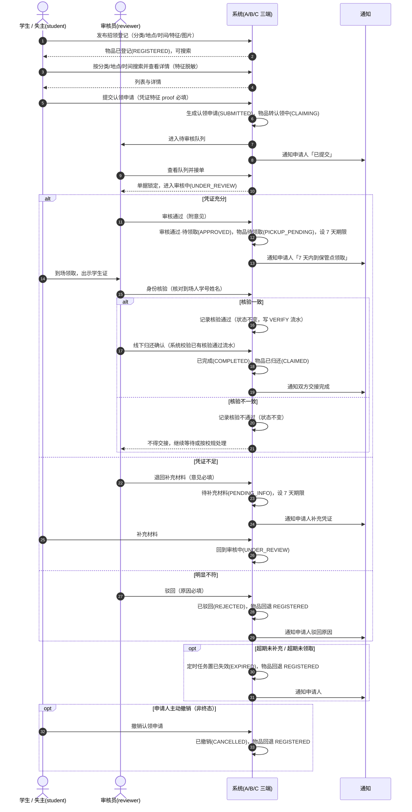
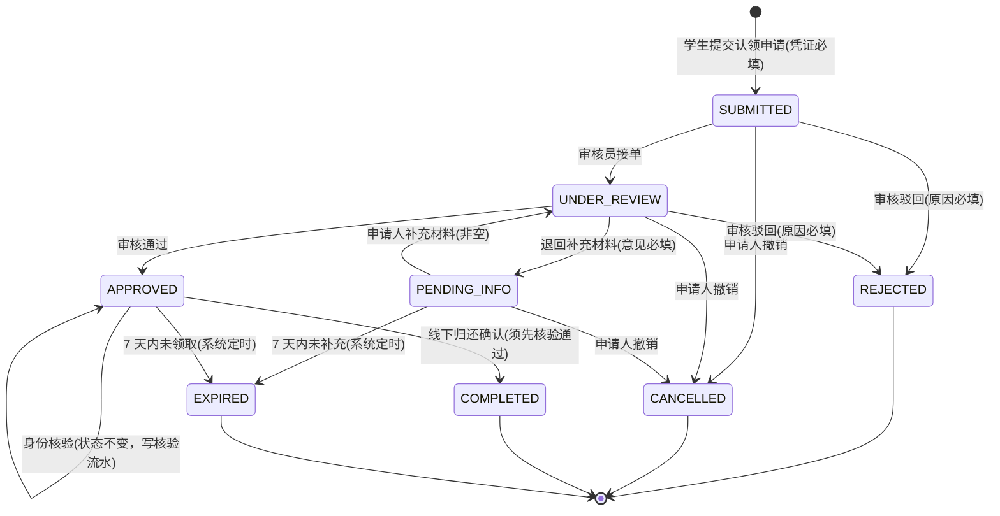

# 需求模型 4 图（补齐 3 张 + 用例图引用）

| 项目 | 内容 |
|---|---|
| 课题 | 校园失物招领与认领审核系统（第 2 组） |
| 负责人 | 阴亮（组长） |
| 版本 | v1（2026-11-04） |
| 依据 | 《需求说明书.md》§3、《用例图.md》UC-01~UC-21、`api-contract-v1.md` §5 |

> 评分表「需求模型完整性 30 分」优秀档点名 **4 图：用例图、顺序图、分析类图、状态图**。用例图见 `01_批次0-阴亮/用例图.md`（UC-01~UC-21，含 2 张 Mermaid + PlantUML 备用 + UC-12 完整规约）；本文件补齐其余 3 张。

---

## 0. 口径说明（先看）

1. **本文件是需求层模型**，描述「业务上发生什么」；李子研 `02-李子研/设计模型/` 的 9 张是**设计层模型**，描述「代码怎么实现」。两者不重复、不互相顶替：
   - 本文件顺序图用「学生 / 审核员 / 系统 / 通知」作参与者，不出现 `StateMachine` `Mapper` 等实现类；
   - 本文件分析类图用**边界类 / 控制类 / 实体类（BCE）**，不写方法签名与字段类型；
   - 本文件状态图描述 8 个业务状态与业务事件，不写 HTTP 路径。
2. **状态与顺序以契约 v1 为准**：身份核验在**审核通过之后、交接之前**，是 `APPROVED` 自环、不改状态；交接前必须存在核验通过流水（不变量 I7）。v0 文档中「核验在审核前」的画法已作废。
3. **UC 编号以《用例图.md》UC-01~UC-21 为准**。契约 v1 §7 的 UC 为简写编号（如 `UC-1` 注册、`UC-18` 用户管理），与用例图不一致，建议由李子研同步修订契约 §7；本组文档与追踪矩阵统一采用用例图编号。

---

## 1. 顺序图（图 3-1）

对应用例 UC-02、UC-04、UC-06、UC-10、UC-11、UC-12、UC-14；覆盖需求 FR-02/04/06/08/09/10/12。



**图 3-1　认领审核主流程顺序图（需求层，含三条异常分支与两个可选分支）**

> 需求可验证点：① 核验与交接是两步，顺序不可颠倒；② 核验通过才允许交接（I7）；③ 驳回 / 撤销 / 超期均使物品回到可再认领状态，不产生死锁；④ 每次关键动作都有通知与留痕。

---

## 2. 分析类图（图 3-2）

采用边界类 / 控制类 / 实体类（BCE）划分，只表达业务概念及其关系，**不含实现方法、字段类型与技术构件**。

```mermaid
classDiagram
    <<boundary>> 学生端界面
    <<boundary>> 审核端界面
    <<boundary>> 后台管理界面
    <<control>> 登记与检索控制
    <<control>> 认领申请控制
    <<control>> 审核流程控制
    <<control>> 身份核验控制
    <<control>> 台账与统计控制
    <<entity>> 用户
    <<entity>> 拾获物品
    <<entity>> 失物启事
    <<entity>> 分类字典
    <<entity>> 地点字典
    <<entity>> 认领申请
    <<entity>> 审核流水
    <<entity>> 通知
    <<entity>> 操作日志

    学生端界面 ..> 登记与检索控制 : 提交登记 / 搜索
    学生端界面 ..> 认领申请控制 : 提交申请 / 补充 / 撤销
    审核端界面 ..> 审核流程控制 : 接单 / 通过 / 驳回 / 退补 / 交接
    审核端界面 ..> 身份核验控制 : 核对到场人
    后台管理界面 ..> 台账与统计控制 : 用户 / 字典 / 统计 / 日志

    登记与检索控制 --> 拾获物品 : 创建 / 查询
    登记与检索控制 --> 失物启事 : 创建 / 查询
    登记与检索控制 --> 分类字典 : 读取
    登记与检索控制 --> 地点字典 : 读取

    认领申请控制 --> 认领申请 : 创建 / 变更状态
    认领申请控制 --> 拾获物品 : 关联并联动状态
    审核流程控制 --> 认领申请 : 驱动状态流
    审核流程控制 --> 审核流水 : 每次迁移留痕
    身份核验控制 --> 认领申请 : APPROVED 自环，不改状态
    身份核验控制 --> 审核流水 : 写 VERIFY 流水
    审核流程控制 ..> 身份核验控制 : 交接前校验 I7

    台账与统计控制 --> 用户 : 管理
    台账与统计控制 --> 分类字典 : 维护
    台账与统计控制 --> 地点字典 : 维护
    台账与统计控制 --> 操作日志 : 查询 / 导出
    审核流程控制 --> 操作日志 : 关键动作留痕
    审核流程控制 --> 通知 : 触发
    认领申请控制 --> 通知 : 触发

    用户 "1" -- "0..*" 拾获物品 : 拾获登记
    用户 "1" -- "0..*" 失物启事 : 发布
    用户 "1" -- "0..*" 认领申请 : 申请
    用户 "1" -- "0..*" 认领申请 : 审核(reviewer)
    拾获物品 "1" -- "0..*" 认领申请 : 被认领
    认领申请 "1" -- "1..*" 审核流水 : 回放历史
    分类字典 "1" -- "0..*" 拾获物品 : 分类
    地点字典 "1" -- "0..*" 拾获物品 : 地点
    用户 "1" -- "0..*" 通知 : 接收
```

**图 3-2　分析类图（BCE，需求层）**

> 与李子研《设计模型/06-类图.md》的区别：那张是 B 端实现结构（Claim / ReviewRecord / StateMachine 等实现类与方法），本图是需求分析阶段的领域概念，用于说明「需求里有哪些东西、谁驱动谁」。两张都要交，分别对应需求模型与设计模型。

---

## 3. 状态图（图 3-3）

描述 `claim`（认领申请）的 8 个业务状态与触发事件，业务语言表述，不含接口路径。



**图 3-3　认领申请状态图（需求层，8 态）**

| 业务规则 | 说明 |
|---|---|
| 终态封闭 | 已驳回 / 已撤销 / 已完成 / 已失效不再迁移，任何触发返回「非法状态迁移」 |
| 核验自环 | 身份核验是 `APPROVED` 状态上的自环，**不改变状态**，只产生核验流水 |
| 交接前置 | 归还确认必须存在该单据的核验通过流水（不变量 I7），否则拒绝 |
| 物品联动 | 提交→认领中、通过→待领取、交接→已归还；驳回 / 撤销 / 超期回退已登记 |
| 超时收敛 | 待补充材料、审核通过·待领取两态携带 7 天期限，超期统一失效 |

> 实现层状态机图（含 HTTP 路径与 7 条不变量）见 `api-contract-v1.md` §5 与《设计模型/02-状态机图.md》，两图同源，冲突时以契约为准。

---

## 4. 4 图与交付物对照（提交前自查）

| 图 | 文件 | 层 | 主责 | 状态 |
|---|---|---|---|---|
| 用例图 | `01_批次0-阴亮/用例图.md`（UC-01~UC-21，2 张 Mermaid + PlantUML 备用） | 需求 | 阴亮 | ✅ |
| 顺序图 | 本文件 §1 图 3-1 | 需求 | 阴亮 | ✅ |
| 分析类图 | 本文件 §2 图 3-2（BCE） | 需求 | 阴亮 | ✅ |
| 状态图 | 本文件 §3 图 3-3（8 态） | 需求 | 阴亮 | ✅ |
| 附：9 张设计模型 | `02-李子研/设计模型/01~09` | 设计 | 李子研 | ✅（另计设计模型 30 分） |

## 5. 修订记录

| 版本 | 日期 | 修改人 | 说明 |
|---|---|---|---|
| **v1** | **2026-11-04** | **阴亮** | **按 `api-contract-v1.md` 补齐需求 4 图之 2-4；统一身份核验顺序与 I7；UC 编号以用例图为准** |
