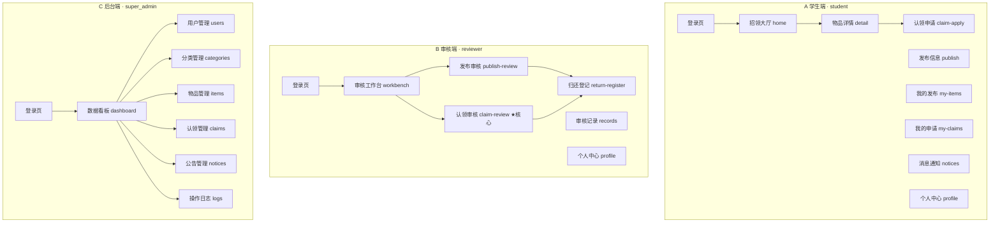

# 用户界面模型（UI Model）

> 设计 7 种模型之七 · 对应指导书「设计规格说明书」模型完整性要求。
> 版本：v1（对齐 `api-contract-v1.md` 与《术语表-v1》）
> 角色口径：`student` / `reviewer` / `super_admin`（v0 的 `user/admin`、`STUDENT/AUDITOR/ADMIN` 已废弃）
> 注：`03_批次0-邓昌兴/页面清单.md` 现仍为 v0 角色码，本文件以 v1 口径为唯一准。

---

## 1. 模型目的与范围

用户界面模型描述系统**三端入口的导航结构、关键界面的区域划分、以及界面与用例/接口的映射关系**，用于：

- 在编码前锁定三端界面骨架，避免「学生端 / 审核端 / 后台端」互相串门；
- 作为前端实现（演示主口径 `src/lost-found-prototype/`）与页面清单的对照基线；
- 支撑「软件产品宣传彩页」「演示视频」的取景选择。

本模型不替代视觉设计（配色、字体），只定义**结构、区域、控件语义与导航**。

---

## 2. 三端导航结构（总览）

角色隔离由路由守卫强制：`roles` 不匹配时跳回各自 `ROLE_HOME`，跨端 URL 直接 404。

---

## 3. 关键界面区域划分

### 3.1 登录页（三端共用骨架）

| 区域 | 控件 | 语义 |
|---|---|---|
| 顶部 | 系统标题「校园失物招领与认领审核系统」 | 品牌 |
| 表单区 | 学号 `student_no` 输入框、密码框、登录按钮 | 凭证录入 |
| 提示区 | 登录失败原因（如「账号或密码错误」「该账号无审核权限」） | 反馈 |

> 角色不在登录时选择，由后端按 `student_no` 返回 `role` 决定落地页。

### 3.2 A 端 · 招领大厅 `home`（首页）

| 区域 | 内容 |
|---|---|
| 顶部搜索条 | 关键词 + 分类/地点/类型/时间筛选 + 分页 |
| 卡片列表 | 每张卡片：物品缩略图、标题、分类标签、地点、状态徽标（已审核/待审核对普通学生隐藏） |
| 发布入口 | 右上角浮动「+ 发布」按钮 → `publish` |
| 侧栏/底栏 | 我的发布、我的申请、消息、个人中心导航 |

### 3.3 B 端 · 认领审核 `claim-review`（核心界面）

| 区域 | 内容 | 对应不变量 |
|---|---|---|
| 左：待审队列 | 列表：`申请人 / 物品 / 提交时间 / 状态`，点击进入详情 | — |
| 中：申请详情 | 物品信息、申请描述的特征、申请人上传的**凭证图** | — |
| 右：审核操作 | 通过 / 驳回 / 要求补充；通过后进入「身份核验」 | 通过 → `APPROVED` |
| 核验区 | 核对到场人证件与申请特征，点「身份核验通过」→ 写 `VERIFY` 流水，**状态不变**（I7） | `APPROVED` 自环 |
| 交接区 | 核验通过后开放「确认交接」→ 状态 `COMPLETED`，物品 `CLAIMED` | I7 前置 |

> 关键防呆：**未核验通过时点交接 → 前端禁用按钮 + 后端返回 `40003`（I7 拦截）**。该拦截已有真实界面截图佐证（见 §5）。

### 3.4 C 端 · 后台管理端页面组 `super_admin`（#25–30，已在原型实现）

> 仅 `super_admin` 可见，学生/审核端菜单无此入口，是「管理员权限最多」的界面实证。原型已实跑验证：`super001` 登录可见全部 5 页；`stu001` 越权访问返回 `40002`。

| 页面 | 区域 / 内容 | 接口（v1 编号） |
| --- | --- | --- |
| 数据看板 `dashboard` | 指标卡（物品总数/待审数/认领成功率/平均审核时长/各状态计数）+ 快捷管理入口 | `#29 GET /admin/stats/overview` |
| 用户管理 `users` | 用户列表、启用/停用（停自己返回 `40003`、停其他超管有校验） | `#25 GET /admin/users`、`#26 PUT /admin/users/{uid}/status` |
| 分类字典 `categories` | 物品分类维护（增/查） | `#27 GET/POST /admin/dict/categories` |
| 地点字典 `locations` | 拾获地点维护（增/查） | `#28 GET/POST /admin/dict/locations` |
| 操作日志 `logs` | 审计流水查询 + 认领单 CSV 导出（utf-8-sig，Excel 可读） | `#30 GET /admin/audit-logs`、`#30 GET /admin/export/claims.csv` |

---

## 4. 界面 ↔ 用例 ↔ 接口 映射（节选 P0）

| 界面 | 主用例 | 关键接口（v1 编号） |
|---|---|---|
| 登录页 | UC-01 登录 | `#1 POST /auth/login` |
| 招领大厅 | UC-02 浏览检索 | `#3 GET /items` |
| 物品详情 | UC-03 查看详情 | `#4 GET /items/{id}` |
| 发布信息 | UC-04 发布招领 | `#5 POST /items` |
| 认领申请 | UC-06 提交认领 | `#8 POST /claims` |
| 审核工作台 | UC-07 接单 | `#12 POST /review/claims/{id}/pick` |
| 认领审核 | UC-09 审核通过 | `#14 POST /review/claims/{id}/approve` |
| 身份核验 | UC-11 身份核验 | `#19 POST /review/claims/{id}/verify`（自环·I7） |
| 归还登记 | UC-14 线下归还确认 | `#23 POST /review/claims/{id}/handover`（I7 前置） |
| 数据看板 | UC-18 运营统计 | `#29 GET /admin/stats/overview` |
| 用户管理 | UC-17 用户管理 | `#25 GET /admin/users`、`#26 PUT /admin/users/{uid}/status` |
| 分类字典 | UC-19 字典维护 | `#27 GET/POST /admin/dict/categories` |
| 地点字典 | UC-19 字典维护 | `#28 GET/POST /admin/dict/locations` |
| 操作日志 | UC-20 审计与导出 | `#30 GET /admin/audit-logs`、`#30 GET /admin/export/claims.csv` |

完整 UC-01~21 与接口 #1~30 见 `api-contract-v1.md` 与 `用例图.md`。

---

## 5. 界面原型素材（已实跑）

演示主口径 `src/lost-found-prototype/` 已产出 6 张真实业务界面截图，覆盖主链关键帧：

| 截图 | 对应界面/状态 | 佐证点 |
|---|---|---|
| `01-登录页.png` | 登录页 | 学号/密码/登录按钮完整 |
| `02-A端招领列表.png` | 招领大厅 | 卡片列表、筛选 |
| `03-B端审核队列.png` | 审核工作台 | 待审队列 |
| `04-未核验交接被I7拦截.png` | 认领审核·交接拦截 | **40003 中文红显 + 主链进度条**，证明 I7 生效 |
| `05-交接完成COMPLETED.png` | 归还登记·完成 | 状态 `COMPLETED`、物品 `CLAIMED` |
| `06-VERIFY自环流水.png` | 身份核验流水 | `VERIFY` 流水写入、状态不变 |

> 这 6 张图即「软件界面模型」的可运行证据，也是宣传彩页与演示视频的取景源。

---

## 6. 现状与边界（答辩如实讲）

- **界面模型已建，C 端 #25–30 已在 FastAPI 原型内实现并验证**（数据看板/用户管理/分类字典/地点字典/操作日志/CSV 导出）：`super001` 登录可见五个管理页，学生越权被 `40002` 拦截，管理员停自己被 `40003` 拦截。邓的 `lost-found-web` 中对应 9 页仍为占位骨架，正式 Spring Boot 后端平移中 → 答辩讲 C 端时按「原型已跑通、Spring Boot 平移中」如实表述，**不造假数据**。
- 演示与视频统一用 `src/lost-found-prototype/`：主链（A→B 审核→核验→交接）+ §3.1.5 C 端管理页演示（管理员权限最多）。
- 本文件与《需求 4 图》《体系结构/构件/部署图》互补：需求层画「谁用什么」，设计层本文件画「界面长什么样、怎么导航」。

---

*v1 修订：新建本文件补齐设计第 7 种模型（用户界面模型）；角色码统一 student/reviewer/super_admin；界面-用例-接口映射对齐 api-contract-v1。*
